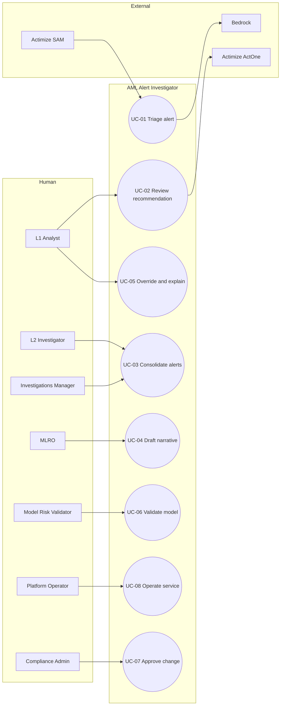

# Use Cases and User Stories

| | |
|---|---|
| **Document ID** | AMLI-UC-001 |
| **Version** | 0.1 |
| **Status** | Draft — for review |
| **Owner** | Business Analyst |
| **Date** | 18 November 2026 |
| **Classification** | Internal |

---

## 1. Actors

| Actor | Type | Description |
|---|---|---|
| **L1 Analyst** | Human, primary | Reviews recommendations, decides dispositions on alerts |
| **L2 Investigator** | Human | Works escalated cases, deeper enquiry |
| **Investigations Manager** | Human | Owns the queue, allocation, quality sampling |
| **MLRO** | Human | Approves report versions and decides filing |
| **Model Risk Validator** | Human | Independent validation and ongoing monitoring |
| **Platform Operator** | Human | Runs the service, handles incidents |
| **Compliance Administrator** | Human | Manages policy, thresholds, configuration approvals |
| **Investigator Agent** | System | The AI agent that assembles evidence and recommends |
| **Actimize SAM** | External system | Source of alerts, parties, accounts, transactions |
| **Actimize ActOne** | External system | Case management system of record |
| **Bedrock LLM Service** | External system | Model inference provider |

---

## 2. Use case catalogue

| ID | Name | Primary actor | Priority |
|---|---|---|---|
| UC-01 | Triage an incoming alert | Investigator Agent | M |
| UC-02 | Review and decide a recommendation | L1 Analyst | M |
| UC-03 | Consolidate alerts into a case | L2 Investigator | S |
| UC-04 | Draft a report narrative | MLRO | S |
| UC-05 | Override a recommendation with reason | L1 Analyst | M |
| UC-06 | Validate model performance | Model Risk Validator | M |
| UC-07 | Propose, evaluate and approve a change | Compliance Administrator | M |
| UC-08 | Operate and recover the service | Platform Operator | M |
| UC-09 | Reconstruct a historic investigation | Internal Audit | M |
| UC-10 | Handle an unparseable or ungrounded answer | Investigator Agent | M |
| UC-11 | Withstand a prompt-injection attempt | Investigator Agent | M |
| UC-12 | Ingest and quarantine source data | System | M |
| UC-13 | Write a recommendation back to ActOne | System | M |
| UC-14 | Respond to a data subject request | Compliance Administrator | S |

---

## 3. Detailed use cases

### UC-01 — Triage an incoming alert

| | |
|---|---|
| **Primary actor** | Investigator Agent |
| **Stakeholders** | L1 Analyst (receives output), MLRO (accountable) |
| **Preconditions** | Alert ingested and validated; rule catalogue entry exists for the scenario; a release is deployed |
| **Trigger** | Alert reaches `ready_for_investigation` |
| **Postconditions (success)** | `ai_run` complete; recommendation, findings and evidence persisted; alert queued for human review |
| **Postconditions (failure)** | Run recorded with failure reason; alert routed to manual queue; no recommendation asserted |
| **Requirements** | FR-031 … FR-053 |

**Main flow**

1. The runtime creates an `ai_run` with a trace identifier, the deployment, and the alert.
2. It retrieves the applicable rule version for the scenario and the alert date (FR-015).
3. It captures evidence items for the alert, party, account, transactions and any prior alerts on the party, hashing and snapshotting each (FR-021–FR-024).
4. It renders the investigation context, excluding all label and outcome fields (FR-033), and encloses untrusted free text in the envelope (FR-087).
5. The router selects the least costly serving model meeting the quality floor (FR-034).
6. A control check is evaluated before the call; the outcome is recorded (FR-088).
7. The model call is made through the gateway; tokens, latency and cost are recorded (FR-032).
8. The response is parsed into a verdict (FR-045).
9. Citations are resolved against captured evidence; groundedness is computed deterministically (FR-049).
10. Findings are created, each linked to evidence with a stance (FR-047, FR-048).
11. The recommendation is persisted as a recommendation, not a decision (FR-052).
12. The alert is placed on the review queue.

**Alternate flows**

- **1a. No rule for scenario** → disposition `insufficient_information`, reason `no_rule_for_scenario`, no model call (FR-017).
- **5a. No serving model meets the floor** → run aborts, operator alert, alert routed to manual queue.
- **7a. Provider error** → fallback provider or model attempted (FR-038); if all fail, run recorded failed, alert to manual queue.
- **7b. Timeout** → attempt recorded as `timeout`, not as an empty answer (FR-043).
- **9a. Ungrounded answer** → escalate once to a higher-capability model (FR-035); if still ungrounded, `insufficient_information` (FR-053).
- **Any. Spend cap breached** → run aborts with `budget_exceeded`, alert raised (FR-037).

**Non-functional** — NFR-001 to NFR-003 latency; NFR-054 groundedness; NFR-059 cost.

---

### UC-02 — Review and decide a recommendation

| | |
|---|---|
| **Primary actor** | L1 Analyst |
| **Preconditions** | A recommendation exists; the analyst holds the review permission for the jurisdiction |
| **Trigger** | Analyst opens an alert from the queue |
| **Postconditions** | A `decision` exists with actor, outcome, rationale and agreement flag; the alert leaves the review queue |
| **Requirements** | FR-061 … FR-068 |

**Main flow**

1. The analyst opens the alert. The workspace shows the party and account context, the transactions, the rule that fired with its citation, the recommendation, the reasoning and each finding with its evidence (FR-061, NFR-072).
2. The analyst inspects any piece of evidence in one interaction, rendered from the captured snapshot rather than re-queried (FR-026, NFR-071).
3. The analyst selects accept, override or request more information (FR-062).
4. The system records the decision with the deciding actor, timestamp, rationale and whether it agreed with the recommendation (FR-063, FR-065).
5. On escalation, the permission to escalate is enforced server-side (FR-067).
6. The recommendation and evidence pack are written back to ActOne (UC-13).

**Alternate flows**

- **3a. Override** → the analyst selects a structured reason, which feeds failure mining (FR-064, FR-079).
- **3b. Request more information** → an investigation task is created; the alert returns to the queue when the information arrives.
- **4a. Superseding an earlier decision** → both records are retained, linked by `supersedes` (FR-066).

---

### UC-05 — Override a recommendation with reason

| | |
|---|---|
| **Primary actor** | L1 Analyst |
| **Why it matters** | Overrides are the highest-value training signal the system receives, and the primary input to UC-07 |
| **Requirements** | FR-064, FR-079, FR-080 |

**Main flow**

1. The analyst disagrees with the recommendation and selects override.
2. The system requires a structured reason from a controlled list: *missed context*, *misread transaction pattern*, *ignored declared income or occupation*, *wrong rule applied*, *insufficient evidence gathered*, *correct answer, poor reasoning*, *other*.
3. Free-text elaboration is captured alongside, and is treated as internal content subject to the tipping-off guard (FR-090).
4. The decision is recorded with `agreed_with_recommendation = false`.
5. The override joins the failure-mining input set, clustered on features observable in the alert, never on the label (FR-079).

---

### UC-06 — Validate model performance

| | |
|---|---|
| **Primary actor** | Model Risk Validator |
| **Preconditions** | An adjudicated evaluation dataset version exists with recorded label confidence |
| **Requirements** | FR-077, FR-078, FR-085, NFR-052 … NFR-058 |

**Main flow**

1. The validator selects a release and an evaluation dataset version.
2. The system runs the evaluation against that dataset, recording per-item results.
3. Performance is reported against **adjudicated labels only**, with the label-confidence distribution shown alongside (FR-078).
4. Outcome analysis, calibration and drift are produced per AMLI-MRM-001.
5. A metric below its floor raises a deviation banded in standard errors of the measurement (FR-085, NFR-057).

**Business rule** — a CTR-only outcome does not constitute a positive suspicion label. Reporting that mixes outcome with adjudication is rejected at source.

---

### UC-07 — Propose, evaluate and approve a change

| | |
|---|---|
| **Primary actor** | Compliance Administrator |
| **Supporting** | Model Risk Validator, Head of Financial Crime Technology |
| **Requirements** | FR-079 … FR-084, FR-095 |

**Main flow**

1. Failure mining produces a cluster with an attributed cause and a candidate change (FR-079, FR-080).
2. The change is materialised as a new asset version — prompt, policy, threshold override or routing parameter — never as a runtime toggle (FR-095).
3. A candidate release is assembled and evaluated against the same dataset and baseline using a paired statistical test (FR-081).
4. The gate assesses the result against the value contract.
5. **If recall would fall below the floor, the gate refuses, whatever the cost benefit** (FR-082).
6. On approval, a `change_approval` links the evaluation run, the candidate release and the approver (FR-083).
7. Deployment makes it effective; rollback remains available (FR-084).

---

### UC-10 — Handle an unparseable or ungrounded answer

| | |
|---|---|
| **Primary actor** | Investigator Agent |
| **Why it matters** | This is the safety behaviour that keeps BR-016 true |
| **Requirements** | FR-045, FR-049, FR-050, FR-053 |

**Main flow**

1. The response cannot be parsed into a verdict, or a citation does not resolve to captured evidence.
2. The system records the attempt with its failure classification. It does **not** infer a disposition.
3. If an escalation remains within the configured bound, the run escalates to a higher-capability model (FR-035, FR-036).
4. If the escalated answer is grounded, the run proceeds normally.
5. Otherwise the disposition is `insufficient_information` with an enumerated reason, and the alert is routed to the manual queue.

**Explicitly prohibited** — deriving a disposition from an unparseable response, defaulting to close, or presenting an ungrounded finding to a reviewer without marking it ungrounded.

---

### UC-11 — Withstand a prompt-injection attempt

| | |
|---|---|
| **Primary actor** | Investigator Agent |
| **Threat actor** | Whoever authored the payment reference text |
| **Requirements** | FR-010, FR-087, FR-089, FR-090, FR-041 |

**Main flow**

1. A transaction carries reference text containing instructions — for example an attempt to force a close, to exfiltrate the system prompt, or to induce disclosure that the party is under investigation.
2. Ingestion preserves it verbatim and marks it untrusted (FR-010).
3. The renderer encloses it in the untrusted-data envelope with an explicit preamble (FR-087).
4. The agent treats it as evidence to report. A detected attempt is recorded as a security event linked to the run (FR-089).
5. Even if the model were persuaded, no tool exists to close the alert, write to the party or file a report (FR-041).
6. Any content heading for a customer-visible channel is blocked at the emission boundary; there is no such channel configured (FR-090).

**Postcondition** — the attempt appears in the investigation as reportable evidence of possible structuring behaviour, which is the correct treatment.

---

### UC-09 — Reconstruct a historic investigation

| | |
|---|---|
| **Primary actor** | Internal Audit |
| **Requirements** | NFR-029, NFR-031, FR-020, FR-042 |

**Main flow**

1. The auditor identifies a disposition by case or alert reference, up to seven years old.
2. The system retrieves the run, the exact system and user prompts, the model identifier and parameters, the rule catalogue version, the policy version, and every evidence item with its hash.
3. Hashes are verified against the stored objects.
4. The investigation is re-rendered exactly as the agent and the reviewer saw it.
5. The decision, the deciding actor and any superseding decision are shown.

**Service level** — produced within one hour (NFR-031).

---

## 4. Epics and user stories

### Epic E1 — Evidence-backed triage

| Story | As a | I want | So that |
|---|---|---|---|
| E1-S1 | L1 Analyst | the alert's transactions, party context and the rule that fired on one screen | I do not assemble the evidence by hand |
| E1-S2 | L1 Analyst | every claim in the recommendation to link to the transaction it came from | I can verify it in seconds rather than re-deriving it |
| E1-S3 | L1 Analyst | the agent to say when it cannot support an answer | I am not misled by a confident guess |
| E1-S4 | L1 Analyst | the declared income and occupation shown next to the transaction pattern | an ordinary salary is not read as layering |

### Epic E2 — Human authority

| Story | As a | I want | So that |
|---|---|---|---|
| E2-S1 | MLRO | certainty that nothing files without me | the institution's reporting obligation stays with a person |
| E2-S2 | Investigations Manager | a report of dispositions taken without a human decision | I can show it is always zero |
| E2-S3 | L1 Analyst | my override reason captured in structure | my disagreement improves the system rather than evaporating |

### Epic E3 — Governance and reconstructability

| Story | As a | I want | So that |
|---|---|---|---|
| E3-S1 | Model Risk Validator | performance quoted only against adjudicated labels | the numbers survive challenge |
| E3-S2 | Internal Audit | any disposition replayable with the data of the day | the control is examinable |
| E3-S3 | Compliance Admin | thresholds traceable to the source specification and page | I can prove we follow the configured rule |

### Epic E4 — Safe operation

| Story | As a | I want | So that |
|---|---|---|---|
| E4-S1 | Platform Operator | a spend cap that stops work rather than draining budget | a loop cannot become an invoice |
| E4-S2 | Security Architect | adversarial probes run on every release | a regression in defence blocks the release |
| E4-S3 | Platform Operator | a runbook entry behind every alert | on-call is actionable at 03:00 |
