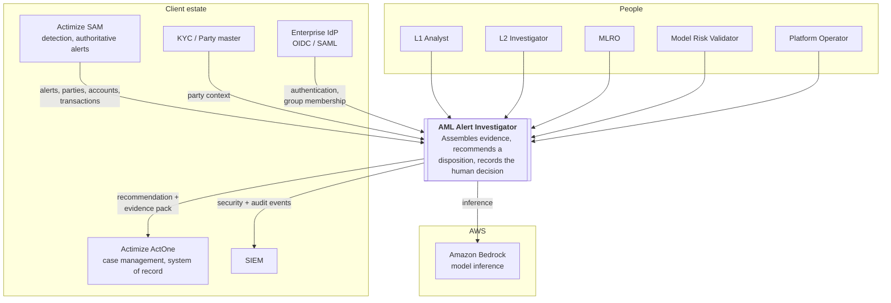
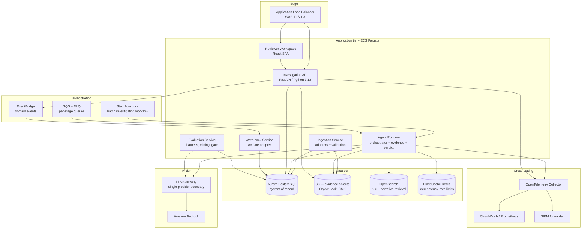
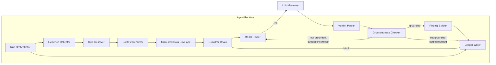
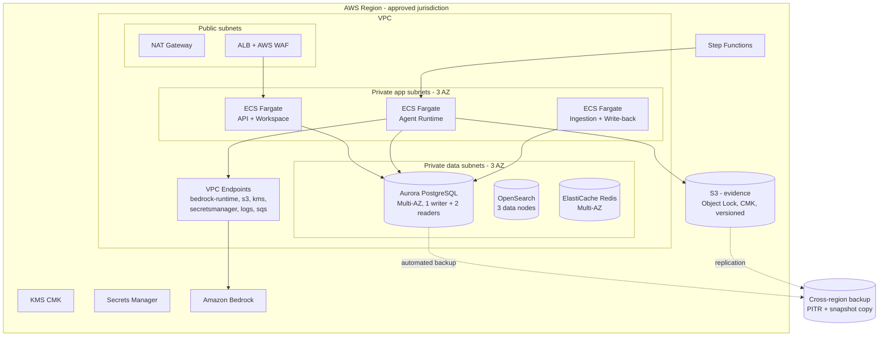

# High-Level Design

| | |
|---|---|
| **Document ID** | AMLI-HLD-001 |
| **Version** | 0.1 |
| **Status** | Draft — for review |
| **Owner** | Solution Architect |
| **Approver** | Head of Financial Crime Technology |
| **Date** | 18 November 2026 |
| **Classification** | Internal |

---

## 1. Architecture principles

| # | Principle | Consequence |
|---|---|---|
| P-1 | **The ledger is the single source of truth.** Every model call, control evaluation and outcome is written once, and every figure is computed from it. | Nothing is asserted in two places. Cost, quality and telemetry reconcile by construction. |
| P-2 | **One run, one join key.** Every artefact of an investigation hangs off `ai_run`. | Build, run, secure and improve are one record set, not four silos. ADR-008. |
| P-3 | **Recommendation and authority are separate records.** | The human decision is data, not a claim in a slide. BR-003, BR-007. |
| P-4 | **Evidence is captured, not referenced.** | A disposition is reconstructable even if the source system changes. BR-006. |
| P-5 | **Determinism where determinism is possible.** Groundedness, thresholds and control checks are computed, not judged. | No model marks its own homework. ADR-004. |
| P-6 | **Dangerous capability is unregisterable, not ungranted.** | A compromised prompt, a persuaded operator and a bug meet the same wall. ADR-005. |
| P-7 | **Untrusted data is enclosed and labelled at the boundary.** | Attacker-controlled text is evidence to report, never instruction to follow. ADR-006. |
| P-8 | **Change is a release, not a setting.** | Prompts, policies, thresholds and routing are versioned assets with approval. ADR-009. |
| P-9 | **Fail to a safe state.** No answer is preferable to an ungrounded one. | BR-016. |
| P-10 | **The incumbent estate stays authoritative.** | We augment Actimize; we do not replace it. ADR-013. |

---

## 2. Context view (C4 level 1)

**What crosses the boundary, and in which direction, is the whole security
story.** Alerts and customer data come in. Recommendations and evidence packs go
back to ActOne. Prompts and completions go to Bedrock inside the approved
region. Nothing goes to a customer, ever (BR-004).

---

## 3. Container view (C4 level 2)

### Container responsibilities

| Container | Responsibility | Does **not** do |
|---|---|---|
| **Ingestion Service** | Pull or receive source records, validate, normalise, quarantine, tag institution and jurisdiction | Investigate, interpret, or write to source |
| **Agent Runtime** | Create the run, capture evidence, retrieve the rule, render, route, call, parse, ground, persist findings and the recommendation | Decide a disposition on the institution's behalf |
| **Investigation API** | Serve the workspace and integrations; enforce authorisation; record decisions | Call models directly |
| **Reviewer Workspace** | Present recommendation, findings and evidence; capture decisions and override reasons | Hold business logic or authorisation decisions |
| **Write-back Service** | Deliver the recommendation and evidence pack to ActOne idempotently | Mutate alert or case status in the source |
| **Evaluation Service** | Run the harness, cluster failures, evaluate proposals, operate the gate | Deploy anything |
| **LLM Gateway** | The only component permitted to open a provider connection; enforces model pinning, spend cap, retries, fallback, token accounting | Business logic, parsing or grading |

---

## 4. Component view (C4 level 3) — Agent Runtime

| Component | Key responsibility | Requirements |
|---|---|---|
| Run Orchestrator | Owns the run lifecycle and the trace identifier; enforces the escalation bound and the spend cap | FR-031, FR-036, FR-037 |
| Evidence Collector | Captures, hashes and stores every consulted source; records access purpose | FR-021 … FR-030 |
| Rule Resolver | Resolves the catalogue version in force for the scenario and date | FR-015, FR-019, FR-020 |
| Context Renderer | Builds the investigation view with no label, adjudication or outcome | FR-033 |
| Untrusted-Data Envelope | Delimits and labels attacker-controllable text | FR-087 |
| Model Router | Chooses the cheapest serving model above the quality floor; handles escalation and fallback | FR-034, FR-035, FR-038 |
| Guardrail Chain | Ordered control checks before call and before emission | FR-088, FR-090 |
| Verdict Parser | Structured parse; never guesses a disposition | FR-045, FR-046 |
| Groundedness Checker | Deterministic citation resolution against captured evidence | FR-049, FR-050 |
| Finding Builder | Creates findings and evidence links with stance | FR-047, FR-048 |
| Ledger Writer | Single writer for call and outcome records | P-1 |

---

## 5. Deployment view (AWS)

### Environments

| Environment | Purpose | Data | Models |
|---|---|---|---|
| `dev` | Development | Synthetic only | Lowest-cost tier |
| `test` | Automated test, contract tests | Synthetic only | Pinned, stubbed by default |
| `uat` | Business acceptance, analyst training | Masked production-like | Production-pinned |
| `preprod` | Release rehearsal, performance, adversarial suite | Masked, production-scale | Production-pinned |
| `prod` | Live | Production | Production-pinned |

No production data is permitted in `dev` or `test` (NFR-047, FR-092).

---

## 6. Technology stack

| Layer | Choice | Rationale | ADR |
|---|---|---|---|
| Language | Python 3.12 | Ecosystem fit for the agent runtime; the reference implementation is already Python | — |
| API framework | FastAPI + Pydantic v2 | Typed contracts, OpenAPI generation from the model | — |
| Workspace | React + TypeScript | Standard; accessibility tooling mature | — |
| System of record | Aurora PostgreSQL 16 | Relational integrity is the point of this data model; RLS gives jurisdiction scoping | ADR-012 |
| Evidence store | S3 with Object Lock | Write-once retention, content-addressed | ADR-011 |
| Retrieval | OpenSearch | Rule catalogue and narrative retrieval | ADR-015 |
| Cache / idempotency | ElastiCache Redis | Idempotency keys, rate limits, short-lived locks | — |
| Orchestration | Step Functions + SQS | Durable batch workflow with visible state and retries | ADR-016 |
| Inference | Amazon Bedrock Converse | Already approved and in use; single API across models | ADR-002 |
| Compute | ECS Fargate | No node management; scales on queue depth | — |
| IaC | Terraform | Client standard | — |
| CI/CD | GitHub Actions → OIDC to AWS | No static credentials | NFR-037 |
| Telemetry | OpenTelemetry → CloudWatch + SIEM | One trace identifier end to end | ADR-017 |

### Model fleet (initial)

| Tier | Model | Role |
|---|---|---|
| Cheap | `us.meta.llama3-3-70b-instruct-v1:0` | First attempt for routine alerts |
| Premium | `mistral.mistral-large-3-675b-instruct` | Escalation target when evidence is absent or ungrounded |
| Rejected | `amazon.nova-lite-v1:0` | Below the quality floor; retained in the fleet file so the refusal is visible and re-testable |

Model identifiers are pinned. A provider version change is a release (NFR-058).

---

## 7. Cross-cutting concerns

| Concern | Approach | Reference |
|---|---|---|
| **Identity** | OIDC to the enterprise IdP; groups map to roles; no local accounts | AMLI-SEC-001 §7 |
| **Authorisation** | Server-side RBAC on every endpoint, plus PostgreSQL row-level security for jurisdiction | FR-097, NFR-038 |
| **Idempotency** | Every mutating API and every outbound delivery carries an idempotency key held in Redis | FR-040, FR-074 |
| **Transactionality** | Outbox pattern — domain write and event emission commit together | AMLI-PAT-001 §3 |
| **Correlation** | `trace_id` created at ingestion, carried through every hop, model call and log line | NFR-033 |
| **Configuration** | Versioned assets, not runtime toggles; environment supplies only endpoints and credentials | ADR-009 |
| **Secrets** | Secrets Manager, rotated; never in environment variables of record | NFR-041 |
| **Error handling** | Typed domain errors; retry with jitter on transient; dead-letter after bounded attempts | NFR-028 |
| **Time** | UTC everywhere; business dates carried separately from timestamps | NFR-032 |
| **Money** | `numeric(18,2)` with explicit currency; never floating point | AMLI-DDL-001 §3 |

---

## 8. Capacity model

Derived from §1 of AMLI-NFR-001.

| Dimension | Steady state | Peak | Basis |
|---|---|---|---|
| Investigations per day | 12,000 | 40,000 | One run per alert |
| Investigations per minute (4h window) | 50 | 67 (10h window) | NFR-005, NFR-006 |
| Agent runtime tasks | 12 | 40 | ~5 concurrent runs per task at 12 s p50 |
| Model calls per day | 13,200 | 44,000 | 10% escalation rate |
| Input tokens per day | ~46M | ~154M | 3,500 tokens per call average |
| Inference cost per day | ~GBP 420 | ~GBP 1,400 | At blended fleet rates |
| Inference cost per alert | ~GBP 0.035 | — | Within NFR-059 |
| Evidence objects per day | ~60,000 | 200,000 | 5 items per investigation |
| Evidence volume per year | ~4 TB | — | 180 KB average object |
| Database rows per year (runs + calls + outcomes) | ~20M | — | Partitioned monthly |

**Headroom.** Task count scales on SQS queue depth with a 30% floor above
measured peak (NFR-012). The binding constraint at peak is Bedrock throughput
quota, not compute — see RISK-006.

---

## 9. Key architectural decisions in brief

Full records in AMLI-ADR-001.

| ADR | Decision |
|---|---|
| ADR-002 | Amazon Bedrock behind a single gateway abstraction |
| ADR-004 | Groundedness computed deterministically, never by an LLM judge |
| ADR-005 | Destructive scopes are unregisterable, not merely ungranted |
| ADR-006 | Untrusted-data envelope at the ingestion boundary |
| ADR-007 | Rule thresholds extracted into a versioned catalogue, never transcribed into prompts |
| ADR-008 | `AI_RUN` as the single join key across all four pillars |
| ADR-009 | Prompts, policies and thresholds are versioned assets released through a gate |
| ADR-010 | Outcome, adjudication and label stored separately |
| ADR-011 | Evidence captured as hashed, write-once objects |
| ADR-012 | Relational system of record; graph projection deferred |
| ADR-013 | Actimize remains authoritative; we write recommendations, never status |

---

## 10. What the reference implementation already proves

Cited so the plan distinguishes what is designed from what is demonstrated.

| Design element | Status in `aml/` |
|---|---|
| Evidence-gated routing with escalation | Implemented and measured |
| Deterministic groundedness | Implemented |
| Untrusted-data envelope with paired A/B probes | Implemented, measured defended vs exploited |
| Ungrantable scopes | Implemented |
| Versioned rule catalogue with page citations | Implemented (28 rules, 4 models) |
| Ledger with cost per outcome | Implemented |
| Failure clustering, paired sign test, refusing gate | Implemented |
| `AI_RUN` as the universal join key | **Partial** — present for model calls, absent for security and evaluation records |
| Case entity and consolidation | **Not built** |
| Evidence capture with hashing and snapshots | **Not built** |
| Decision, actor and override records | **Not built** |
| Outcome / adjudication / label separation | **Not built** |
