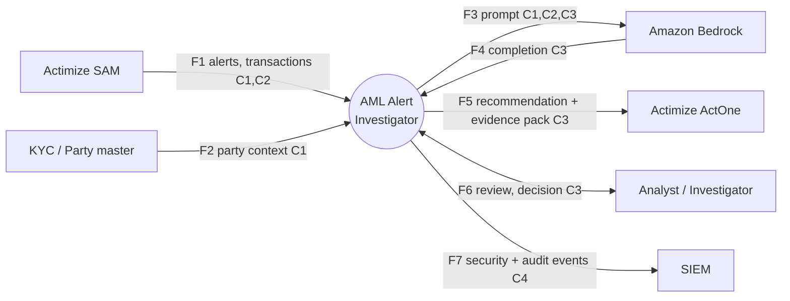
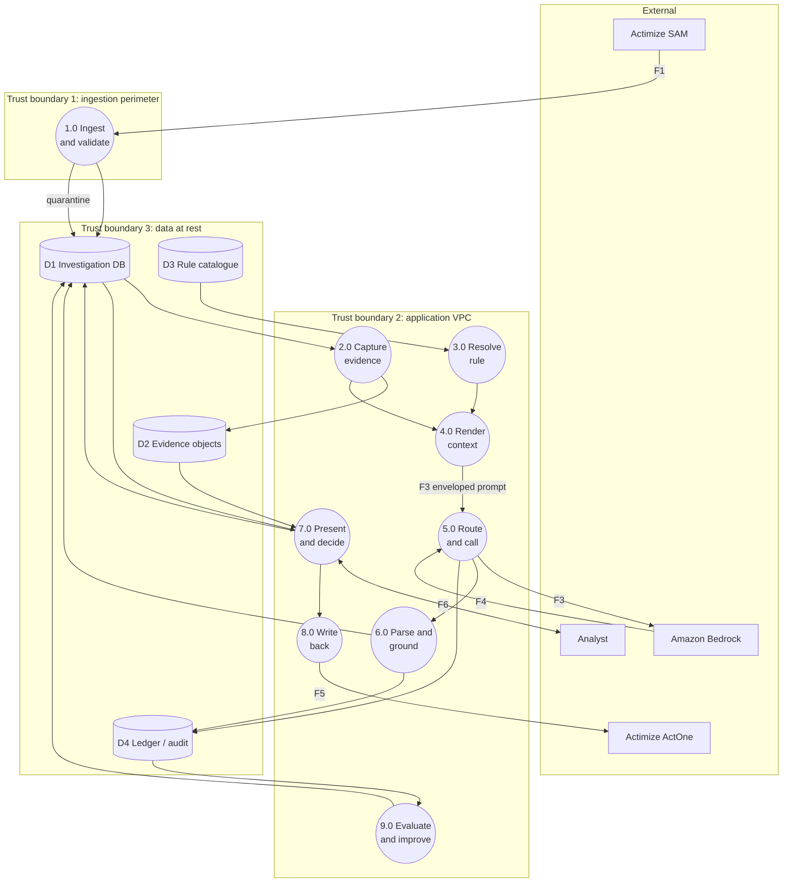
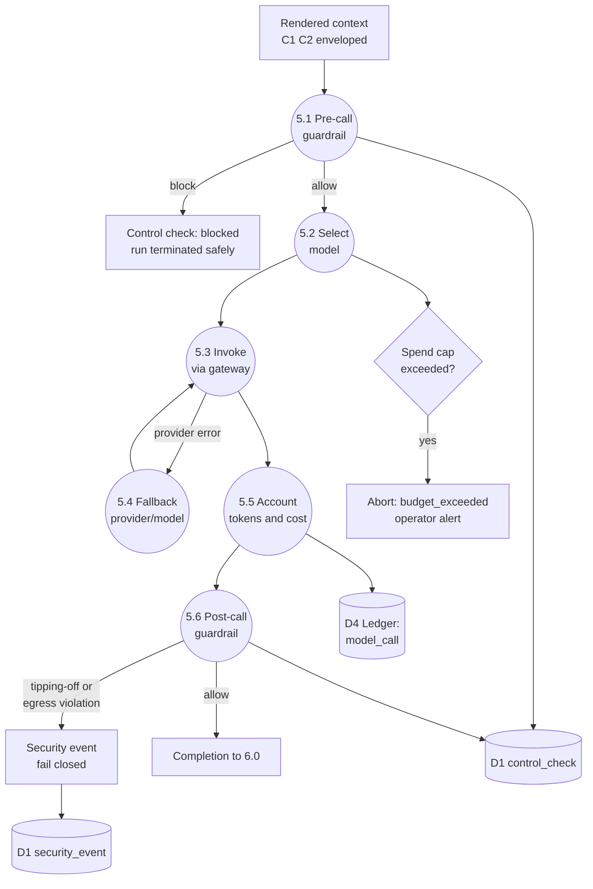
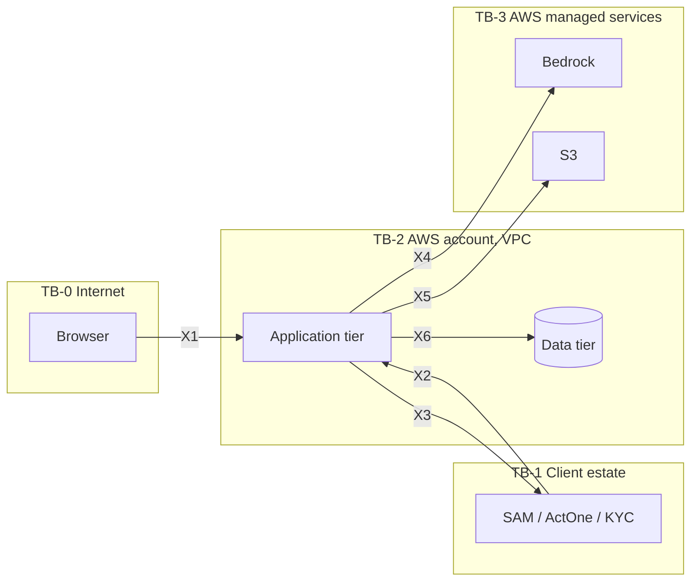

# Data Flow Diagrams and Trust Boundaries

| | |
|---|---|
| **Document ID** | AMLI-DFD-001 |
| **Version** | 0.1 |
| **Status** | Draft — for review |
| **Owner** | Solution Architect |
| **Date** | 18 November 2026 |
| **Classification** | Internal |

---

## 1. Notation and classification

Processes are rounded, data stores are cylinders, external entities are
rectangles, trust boundaries are subgraph frames. Every flow crossing a
boundary is enumerated in §5 with its classification and control.

| Class | Meaning | Examples |
|---|---|---|
| **C1 — Customer PII** | Identifies a natural person | Name, DOB, address, occupation, income, account number |
| **C2 — Transaction detail** | Financial activity, re-identifiable in combination | Amount, date, reference, counterparty, medium |
| **C3 — Suspicion-bearing** | Reveals that a party is under investigation. **Disclosure is a criminal offence.** | Alert existence, case status, finding, SAR narrative |
| **C4 — Operational** | System behaviour without customer content | Latency, token counts, cost, error codes |
| **C5 — Public / reference** | No customer content | Rule thresholds, scenario codes, policy text |

C3 is the controlling classification: anything derived from it inherits it.

---

## 2. Level 0 — Context

There is no flow from the system to any customer-facing channel. That absence is
a control (FR-090), not an omission.

---

## 3. Level 1 — Internal processes

### Process descriptions

| # | Process | In | Out | Store |
|---|---|---|---|---|
| 1.0 | Ingest and validate | Source records (C1, C2) | Normalised records, quarantine entries | D1 |
| 2.0 | Capture evidence | Alert, party, account, transactions (C1, C2) | Hashed snapshots, access records | D2, D1 |
| 3.0 | Resolve rule | Scenario, effective date (C5) | Rule text, thresholds, citation (C5) | D3 |
| 4.0 | Render context | Evidence + rule | Investigation prompt with envelope (C1, C2) | — |
| 5.0 | Route and call | Prompt | Completion, token and cost records (C3, C4) | D4 |
| 6.0 | Parse and ground | Completion | Verdict, findings, groundedness (C3) | D1, D4 |
| 7.0 | Present and decide | Recommendation, findings, evidence | Decision, override reason (C3) | D1 |
| 8.0 | Write back | Recommendation, evidence pack (C3) | Case note in ActOne | — |
| 9.0 | Evaluate and improve | Ledger, decisions, labels (C3, C4) | Clusters, proposals, evaluations | D1 |

---

## 4. Level 2 — Process 5.0, route and call

The detail matters here because this is where untrusted data meets a model and
where cost is incurred.

**Invariants enforced here**

| Invariant | Control |
|---|---|
| No call without a pre-call guardrail evaluation | 5.1 is not bypassable; the gateway rejects a call without a control-check token |
| No completion reaches parsing without a post-call guardrail | 5.6 ordered after accounting so a blocked call is still costed and visible |
| Every call is accounted even when it fails | 5.5 runs on the error path as well as the success path |
| Spend cap stops work rather than degrading quality | Abort, not silently switch to a cheaper model |

---

## 5. Trust boundaries and crossing flows

| ID | Flow | Class | Direction | Controls |
|---|---|---|---|---|
| **X1** | Reviewer browser ↔ Investigation API | C1, C2, C3 | Both | TLS 1.3, WAF, OIDC with MFA, RBAC, RLS, short-lived session, no C3 in URLs or query strings |
| **X2** | SAM / KYC → Ingestion | C1, C2 | Inbound | Private connectivity or mTLS, schema validation, quarantine on failure, institution tagging, no inbound executable content |
| **X3** | Write-back → ActOne | C3 | Outbound | mTLS, idempotency key, least-privilege service account with note-write only, **no status mutation capability** |
| **X4** | LLM Gateway → Bedrock | C1, C2, C3 | Outbound | VPC endpoint (no internet egress), in-region only, CMK, no-training contractual term, prompt captured and hashed, spend cap |
| **X5** | Evidence Collector ↔ S3 | C1, C2, C3 | Both | VPC endpoint, CMK, Object Lock, bucket policy denying unencrypted or cross-region access |
| **X6** | Application ↔ Aurora | C1, C2, C3 | Both | IAM auth, TLS, RLS session context set on acquisition, insert-only grant on audit tables |

### The boundary that does not exist

There is no flow from any process to a customer channel — no email, SMS,
statement, chatbot or portal integration. This is enforced by the absence of any
such adapter and by the post-call guardrail failing closed on customer-directed
content (FR-090). Adding one would require a new trust-boundary crossing, a
threat-model revision and MLRO approval.

---

## 6. Data at rest

| Store | Contents | Class | Encryption | Retention | Immutability |
|---|---|---|---|---|---|
| D1 Investigation DB | Alerts, cases, parties, accounts, transactions, runs, findings, decisions | C1, C2, C3 | CMK at rest, TLS in transit | 7 years | Audit tables insert-only |
| D2 Evidence objects | Captured snapshots | C1, C2, C3 | CMK, SSE-KMS | 7 years | S3 Object Lock, compliance mode |
| D3 Rule catalogue | Thresholds, rule text, citations | C5 | CMK | Indefinite, versioned | Append-only versions |
| D4 Ledger / audit | Model calls, control checks, security events, audit events | C3, C4 | CMK | 7 years | Insert-only, daily hash-chain verification |
| Telemetry | Metrics, traces, logs | C4 only | CMK | 90 days hot, 1 year archive | — |

**Telemetry carries no C1, C2 or C3.** Correlation to an investigation is by
`trace_id` and `run_id` only, and the mapping from those to customer data lives
behind the same access control as the data itself (NFR-047, ADR-017).

---

## 7. Flows that are deliberately absent

Recorded because an absent flow is a design decision and should be reviewable.

| Absent flow | Why |
|---|---|
| Customer data → non-production environments | NFR-047; masked or synthetic only |
| Customer data → model training or fine-tuning | NFR-049; contractual and architectural |
| Agent → alert or case status mutation in SAM/ActOne | ADR-013, FR-075 |
| Agent → regulatory filing endpoint | BR-003, FR-071 |
| Agent → any customer channel | BR-004, FR-090 |
| Model → groundedness judgement | ADR-004 |
| Label or adjudication → rendered prompt | FR-033 |
| Label → failure clustering features | FR-079 |
| Cross-jurisdiction customer data | ADR-014 |
