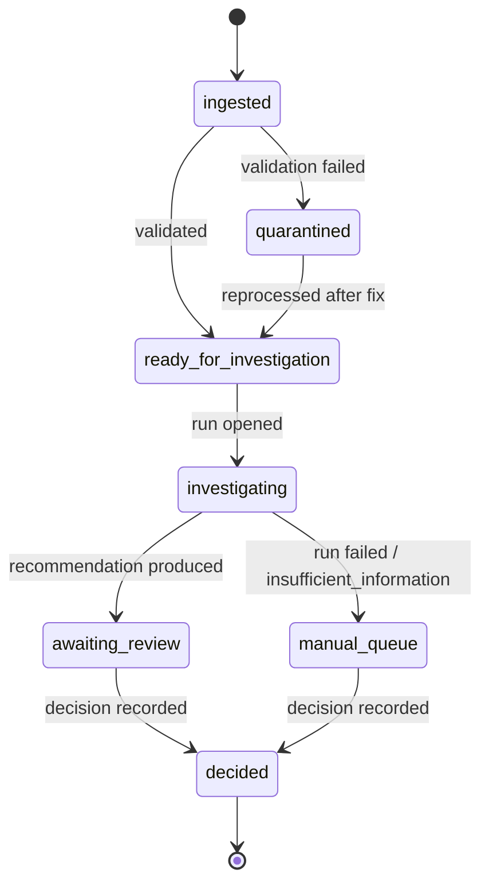
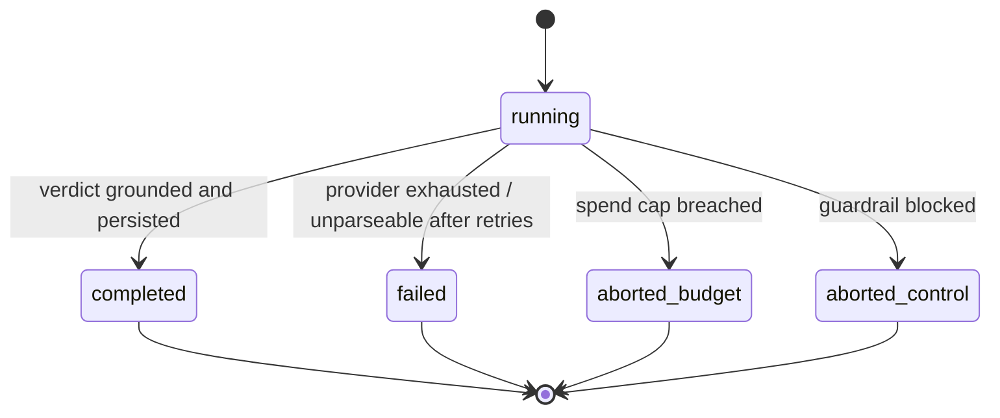
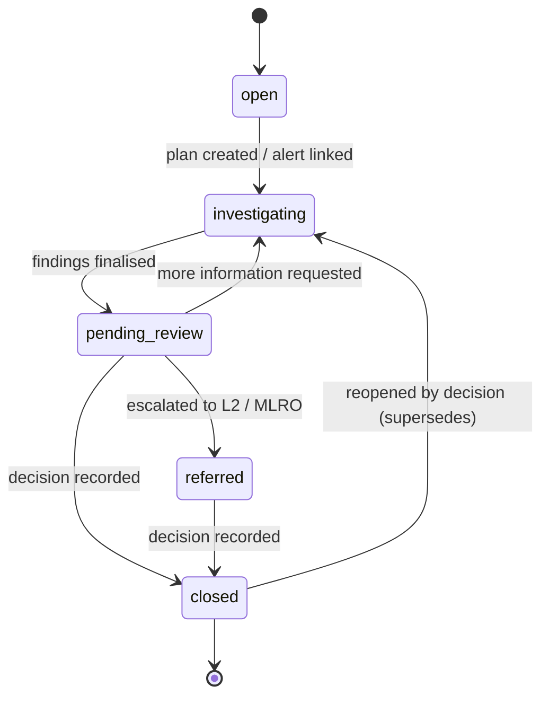
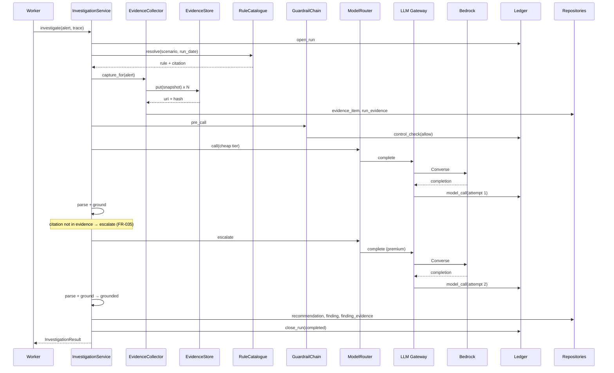
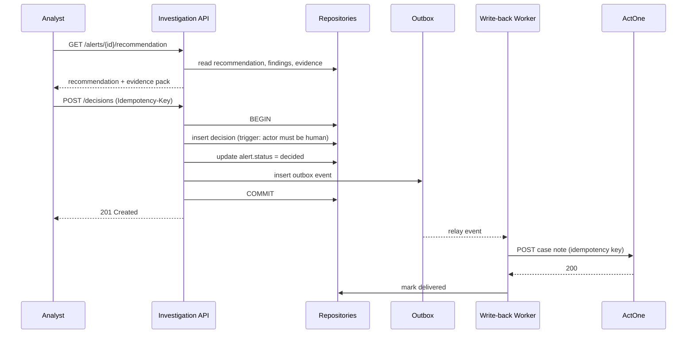

# Low-Level Design

| | |
|---|---|
| **Document ID** | AMLI-LLD-001 |
| **Version** | 0.1 |
| **Status** | Draft — for review |
| **Owner** | Engineering Lead |
| **Date** | 18 November 2026 |
| **Classification** | Internal |

---

## 1. Package structure

```
amli/
├── domain/                      no framework, no SDK, no I/O
│   ├── model/                   entities and value objects
│   │   ├── party.py             Party, Account, Transaction, TransactionRef
│   │   ├── alert.py             Alert, DetectionVersion, Labelling
│   │   ├── investigation.py     Case, CaseAlertLink, Evidence, Finding, Citation
│   │   ├── decision.py          Decision, Actor, DecisionOutcome
│   │   ├── run.py               AiRun, ModelCall, ControlCheck, RunStatus
│   │   └── values.py            Money, ContentHash, Jurisdiction, TraceId
│   ├── policy/
│   │   ├── routing.py           RoutingPolicy, EvidenceGate
│   │   ├── guardrail.py         Guardrail protocol, GuardrailChain
│   │   ├── scopes.py            UNGRANTABLE, ToolRegistry
│   │   └── labelling.py         label derivation rules (ADR-010)
│   ├── service/                 pure orchestration over ports
│   │   ├── investigate.py       InvestigationService — the template method
│   │   ├── evidence.py          EvidenceCollector
│   │   ├── grounding.py         GroundednessChecker
│   │   ├── verdict.py           VerdictParser, Grader
│   │   └── consolidate.py       ConsolidationProposer
│   └── ports/                   protocols only
│       ├── alert_source.py      AlertSource
│       ├── case_sink.py         CaseSink
│       ├── model_provider.py    ModelProvider
│       ├── evidence_store.py    EvidenceStore
│       ├── rule_catalogue.py    RuleCatalogue
│       └── ledger.py            Ledger
├── adapters/
│   ├── actimize/                SAM pull, file extract, ActOne write-back
│   ├── bedrock/                 the ONLY module importing boto3 bedrock-runtime
│   ├── persistence/             SQLAlchemy repositories, unit of work
│   ├── objectstore/             S3 evidence store
│   └── search/                  OpenSearch rule catalogue
├── api/                         FastAPI routers, schemas, auth
├── workers/                     SQS consumers, Step Functions task handlers
├── improve/                     harness, mining, proposal, gate
└── platform/                    config, telemetry, errors, db session
```

**Dependency rule, enforced by an architecture test:** `domain` imports only
from `domain`. `adapters` and `api` may import `domain`. Nothing imports `api`.

```python
# tests/architecture/test_dependencies.py
FORBIDDEN_IN_DOMAIN = {"boto3", "sqlalchemy", "fastapi", "httpx", "redis"}

def test_domain_is_pure():
    for module in walk_modules("amli.domain"):
        for imported in imports_of(module):
            assert imported.split(".")[0] not in FORBIDDEN_IN_DOMAIN, (
                f"{module} imports {imported}; the domain must stay pure"
            )

def test_only_the_gateway_talks_to_the_provider():
    offenders = [m for m in walk_modules("amli")
                 if "bedrock" in imports_of(m)
                 and not m.startswith("amli.adapters.bedrock")]
    assert offenders == [], f"ADR-002 violated by {offenders}"
```

---

## 2. Ports

```python
# amli/domain/ports/model_provider.py
from typing import Protocol

class ModelProvider(Protocol):
    def complete(
        self,
        *,
        system: str,
        user: str,
        model_identifier: str,
        max_tokens: int,
        timeout_s: float,
    ) -> "Completion": ...

@dataclass(frozen=True)
class Completion:
    text: str
    tokens_in: int
    tokens_out: int
    tokens_cached: int
    latency_ms: int
    model_identifier: str
```

```python
# amli/domain/ports/evidence_store.py
class EvidenceStore(Protocol):
    def put(self, payload: bytes, media_type: str) -> "StoredObject": ...
    def get(self, uri: str) -> bytes: ...

@dataclass(frozen=True)
class StoredObject:
    uri: str
    content_hash: ContentHash
    byte_size: int
```

```python
# amli/domain/ports/ledger.py
class Ledger(Protocol):
    def open_run(self, run: AiRun) -> None: ...
    def record_call(self, call: ModelCall) -> None: ...
    def record_control(self, check: ControlCheck) -> None: ...
    def close_run(self, run_id: UUID, status: RunStatus, reason: str | None) -> None: ...
```

The ledger is the **only** writer of `ai_run`, `model_call` and `control_check`
(principle P-1). Repositories for other entities do not touch these tables.

---

## 3. The investigation pipeline

### 3.1 Template method

```python
# amli/domain/service/investigate.py

class InvestigationService:
    """Act, verify, escalate, persist. Fixed skeleton; hooks for variation."""

    def __init__(self, *, evidence: EvidenceCollector, rules: RuleCatalogue,
                 renderer: ContextRenderer, guardrails: GuardrailChain,
                 router: ModelRouter, parser: VerdictParser,
                 grounding: GroundednessChecker, ledger: Ledger,
                 policy: RoutingPolicy, budget: Budget) -> None: ...

    def investigate(self, alert: Alert, trace: TraceId) -> InvestigationResult:
        run = self._open_run(alert, trace)
        try:
            rule = self.rules.resolve(alert.scenario_code, alert.run_date)
            if rule is None:                                   # FR-017
                return self._insufficient(run, "no_rule_for_scenario")

            evidence = self.evidence.capture_for(alert, run)   # FR-021..FR-025
            context = self.renderer.render(alert, evidence, rule)  # FR-033, FR-087

            for attempt in range(1, self.policy.max_escalations + 2):
                self.budget.assert_within(run)                 # FR-037
                decision = self.guardrails.pre_call(context, run)
                if decision.blocked:
                    return self._aborted(run, decision)

                completion, spec = self.router.call(context, run, attempt)
                self.guardrails.post_call(completion, run)     # FR-090

                verdict = self.parser.parse(completion.text)   # FR-045
                if verdict is UNPARSEABLE:
                    continue

                report = self.grounding.check(verdict, evidence)  # FR-049
                if report.grounded or not self.policy.escalate_without_evidence:
                    return self._complete(run, verdict, report, evidence)

                self.router.escalate()                         # FR-035

            return self._insufficient(run, "ungrounded_after_escalation")  # FR-053
        except ProviderUnavailable as exc:
            return self._failed(run, exc)
        finally:
            self.ledger.close_run(run.run_id, run.status, run.termination_reason)
```

Every exit path closes the run. There is no path that leaves a run `running`.

### 3.2 Groundedness — a pure function

```python
# amli/domain/service/grounding.py

@dataclass(frozen=True)
class GroundingReport:
    cited: int
    resolved: int
    invented: tuple[str, ...]

    @property
    def groundedness(self) -> float:
        return self.resolved / self.cited if self.cited else 0.0

    @property
    def grounded(self) -> bool:
        return self.cited > 0 and not self.invented


class GroundednessChecker:
    """A citation resolves, or it does not. No model participates (ADR-004)."""

    def check(self, verdict: Verdict, evidence: EvidenceSet) -> GroundingReport:
        available = evidence.transaction_references()      # set[TransactionRef]
        cited = verdict.citations
        invented = tuple(c for c in cited if c not in available)
        return GroundingReport(
            cited=len(cited),
            resolved=len(cited) - len(invented),
            invented=invented,
        )
```

**Stated limitation.** This verifies that a cited reference *exists*. It does not
verify that the inference drawn from it is sound. That remains with the human
reviewer and with outcome analysis (ADR-004 consequences).

### 3.3 Guardrail chain

```python
class Guardrail(Protocol):
    name: str
    phase: Phase
    def evaluate(self, subject: GuardSubject) -> ControlOutcome: ...


class GuardrailChain:
    def __init__(self, guards: Sequence[Guardrail], policy: PolicyVersion,
                 ledger: Ledger) -> None: ...

    def pre_call(self, context: RenderedContext, run: AiRun) -> ChainDecision:
        return self._run(Phase.PRE_CALL, GuardSubject.of(context), run)

    def post_call(self, completion: Completion, run: AiRun) -> ChainDecision:
        return self._run(Phase.POST_CALL, GuardSubject.of(completion), run)

    def _run(self, phase, subject, run) -> ChainDecision:
        for guard in (g for g in self.guards if g.phase is phase):
            outcome = guard.evaluate(subject)
            self.ledger.record_control(ControlCheck(
                run_id=run.run_id, policy_version_id=self.policy.id,
                control_name=guard.name, phase=phase, outcome=outcome))
            if outcome is ControlOutcome.BLOCK:
                return ChainDecision.blocked(guard.name)
        return ChainDecision.allowed()
```

Registered guardrails:

| Phase | Guardrail | Blocks on |
|---|---|---|
| pre_call | `EnvelopeAssertion` | Untrusted text present outside an envelope |
| pre_call | `ScopeAssertion` | A requested capability is in `UNGRANTABLE` |
| pre_call | `BudgetGuard` | Run or period spend cap exceeded |
| pre_call | `PiiMinimisation` | A field outside the approved projection is present |
| post_call | `TippingOffGuard` | Output addressed to, or describing disclosure to, a customer |
| post_call | `EgressClassification` | Output classification exceeds the destination's permitted class |
| post_call | `SecretScan` | Credential-shaped content in the completion |
| pre_tool | `ToolScopeGuard` | Tool not granted to this deployment |

### 3.4 Unregisterable scopes

```python
# amli/domain/policy/scopes.py

UNGRANTABLE: frozenset[str] = frozenset({
    "alert.close", "case.delete", "sar.file",
    "party.write", "payment.release", "watchlist.write",
})

class ScopeUngrantable(RuntimeError):
    """Raised at registration time, not at call time."""


class ToolRegistry:
    def register(self, scope: str, handler: Callable) -> None:
        if scope in UNGRANTABLE:
            raise ScopeUngrantable(
                f"{scope} cannot be registered. See ADR-005. A product decision "
                f"to permit it is a code change with a design review, not a "
                f"configuration grant."
            )
        self._handlers[scope] = handler
```

Called during application start-up. A violation prevents the service from
starting, so it cannot be discovered in production (FR-041).

---

## 4. State machines

### 4.1 Alert lifecycle



**Only a `decision` moves an alert to `decided`.** No automated transition into
that state exists (BR-003).

### 4.2 Run lifecycle



### 4.3 Case lifecycle



---

## 5. Sequence diagrams

### 5.1 Single alert, happy path with escalation



### 5.2 Human decision and write-back



### 5.3 Prompt-injection attempt

```mermaid
sequenceDiagram
  participant SAM as Actimize SAM
  participant IN as Ingestion
  participant RN as Renderer
  participant GC as GuardrailChain
  participant GW as LLM Gateway
  participant SE as security_event

  SAM->>IN: transaction with hostile reference_text
  IN->>IN: preserve verbatim, untrusted = true
  RN->>RN: wrap in untrusted-data envelope
  GC->>GC: InjectionDetector matches payload signature
  GC->>SE: security_event(prompt_injection, medium)
  Note over GC: Detection records; it does not block.<br/>The text is evidence and must reach the investigation.
  GC->>GW: allow
  GW-->>RN: completion
  GC->>GC: post_call TippingOffGuard
  Note over GC: No customer channel exists; no tool can close<br/>or file. The attempt becomes reportable evidence.
```

---

## 6. Error handling

### 6.1 Taxonomy

```python
class AmliError(Exception): ...

class DomainError(AmliError): ...          # a rule was violated — do not retry
class ValidationError(DomainError): ...
class ScopeUngrantable(DomainError): ...
class LabelIntegrityError(DomainError): ...

class TransientError(AmliError): ...       # retry with backoff
class ProviderThrottled(TransientError): ...
class ProviderTimeout(TransientError): ...
class StoreUnavailable(TransientError): ...

class PermanentError(AmliError): ...       # dead-letter
class ProviderRejected(PermanentError): ...
class SchemaMismatch(PermanentError): ...

class BudgetExceeded(AmliError): ...       # abort, alert, do not retry
```

### 6.2 Policy

| Error | Attempts | Backoff | Terminal state | Alert |
|---|---|---|---|---|
| `ProviderThrottled` | 5 | exp, base 1s, full jitter, cap 30s | fallback model, then `failed` | On sustained rate |
| `ProviderTimeout` | 3 | exp, base 2s, jitter | fallback, then `failed` | P3 |
| `ProviderRejected` | 1 | — | `failed`, DLQ | P2 |
| `StoreUnavailable` | 5 | exp, base 0.5s | `failed` | P1 |
| `ValidationError` on ingest | 1 | — | `quarantined` | Daily digest |
| `BudgetExceeded` | 0 | — | `aborted_budget` | **P1 immediate** |
| `ScopeUngrantable` | 0 | — | service does not start | **P1 immediate** |
| `LabelIntegrityError` | 0 | — | write rejected | P2 |

**Full jitter is specified, not optional.** Equal backoff across a fleet turns a
provider blip into a synchronised retry storm.

### 6.3 Invariants that must never be violated

| Invariant | Enforcement |
|---|---|
| No disposition without a human decision | DB trigger `decision_requires_human` |
| No run left `running` | `finally` block closes every path |
| No model call unaccounted | Ledger write on both success and error paths |
| No label without basis and confidence | DB check `alert_label_complete` |
| No CTR-inferred suspicion label | DB check `alert_ctr_never_labels` |
| No final finding without a resolved supporting citation | DB trigger `finding_final_requires_citation` |
| No provider connection outside the gateway | Architecture test |
| No ungrantable scope registered | Start-up assertion |

---

## 7. Concurrency and consistency

| Concern | Approach |
|---|---|
| Two workers claiming one alert | `SELECT … FOR UPDATE SKIP LOCKED` on the work query; SQS visibility timeout as a second line |
| Duplicate delivery from SQS | Idempotency key on `run_id` derivation: a repeat produces the same run, not a second |
| Decision race between two reviewers | Optimistic concurrency on `alert.status` with a version column; the loser receives 409 and refreshes |
| Outbox relay at-least-once | Consumers idempotent by `Idempotency-Key`; ActOne note carries the key |
| Materialised view staleness | Refreshed concurrently every 30 s; the detail view reads the base tables, so a decision never acts on stale data |
| Long-running batch vs interactive | Separate task pools and queues (bulkhead) |

---

## 8. Configuration

```python
@dataclass(frozen=True)
class RuntimeConfig:
    """Environment supplies endpoints and credentials. Nothing behavioural."""
    database_url: SecretStr
    evidence_bucket: str
    bedrock_region: str
    queue_urls: Mapping[str, str]
    otel_endpoint: str

@dataclass(frozen=True)
class AgentConfig:
    """Behavioural. A versioned asset, hashed onto every run (ADR-009)."""
    system_prompt_version: str
    routing_policy: RoutingPolicy
    guardrail_policy_version: str
    rule_catalogue_version: str
    max_tokens: int
    model_pins: Mapping[str, str]

    def content_hash(self) -> ContentHash: ...
```

**There is no runtime toggle for a model, prompt, policy or threshold.** A
change to any of them produces a new `AgentConfig`, a new asset version, a
release and an approval.
