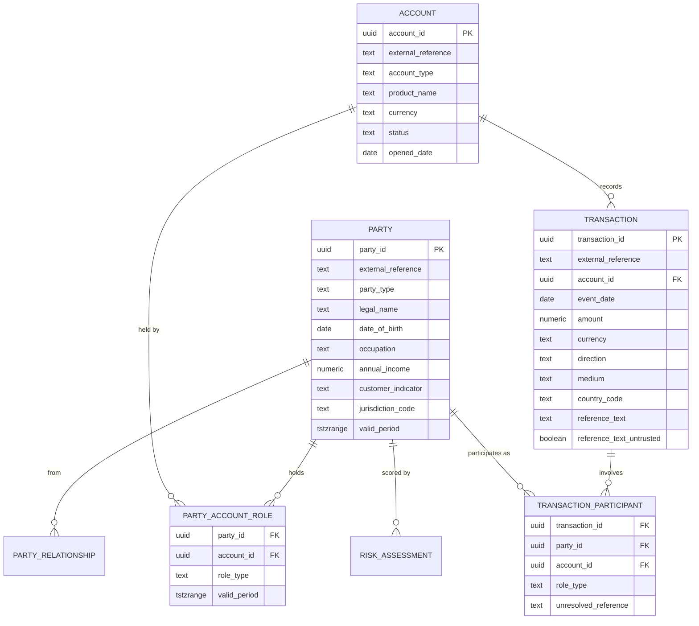
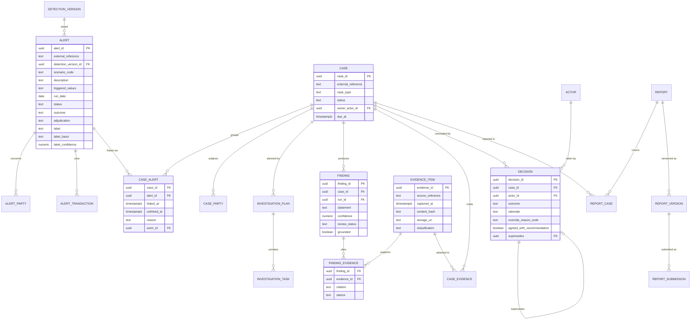
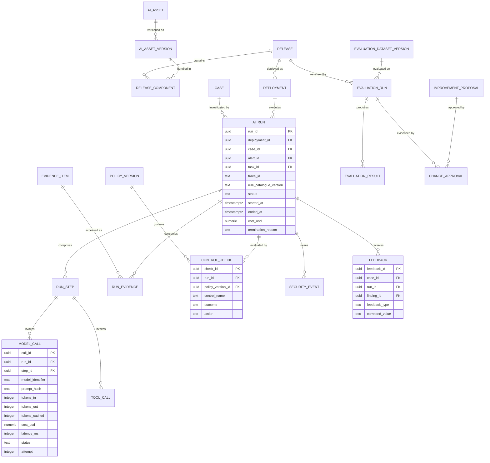

# Logical Data Model

| | |
|---|---|
| **Document ID** | AMLI-DM-001 |
| **Version** | 0.1 |
| **Status** | Draft — for review |
| **Owner** | Data Architect |
| **Approver** | Head of Financial Crime Technology |
| **Date** | 18 November 2026 |
| **Classification** | Internal |

---

## 1. Shape of the model

Three domains, joined by one record.

| Domain | Question it answers | Entities |
|---|---|---|
| **A — Financial crime context** | What happened, to whom, on what account | `party`, `account`, `transaction`, `party_account_role`, `party_relationship`, `transaction_participant`, `risk_assessment` |
| **B — Investigation and reporting** | What was detected, investigated, found and decided | `detection_version`, `alert`, `alert_party`, `alert_transaction`, `case`, `case_alert`, `case_party`, `investigation_plan`, `investigation_task`, `evidence_item`, `case_evidence`, `finding`, `finding_evidence`, `decision`, `report`, `report_version`, `report_submission` |
| **C — AI lifecycle** | What the AI did, under what controls, and how it is improving | `ai_asset`, `ai_asset_version`, `release`, `release_component`, `deployment`, `ai_run`, `run_step`, `model_call`, `tool_call`, `run_evidence`, `control_check`, `security_event`, `policy_version`, `feedback`, `evaluation_dataset_version`, `evaluation_run`, `evaluation_result`, `improvement_proposal`, `change_approval`, `audit_event` |

Supporting entities span all three: `actor`, `team`, `role_assignment`,
`source_system`, `external_reference`, `retention_policy`, `legal_hold`.

**`ai_run` is the integration point** (ADR-008). Every model call, control
check, evidence access and piece of feedback hangs off it, and it carries the
case it served and the deployed release that produced it.

---

## 2. Implementation phasing

Per ADR-018, thirteen entities are built first; the rest are specified here as
the target and phased in AMLI-PLAN-001.

| Entity | Phase | Note |
|---|---|---|
| `party`, `account`, `transaction`, `alert`, `actor` | **1** | Core context |
| `case`, `case_alert`, `ai_run`, `evidence_item`, `finding`, `finding_evidence`, `decision`, `control_check` | **2** | Core investigation and AI spine |
| `model_call`, `run_evidence`, `security_event`, `policy_version`, `detection_version`, `alert_party`, `alert_transaction`, `case_party` | **2** | Completes the spine |
| `investigation_plan`, `investigation_task`, `case_evidence`, `feedback`, `evaluation_*`, `improvement_proposal`, `change_approval` | **3** | Improvement loop |
| `ai_asset`, `ai_asset_version`, `release`, `release_component`, `deployment`, `run_step`, `tool_call` | **3** | Asset and release registry |
| `report`, `report_version`, `report_submission` | **4** | Reporting support |
| `party_relationship`, `transaction_participant`, `party_account_role`, `risk_assessment` | **4** | Network dimension, gated on DEP-004 |

---

## 3. Domain A — Financial crime context

**Relationship rules**

| Rule | Why |
|---|---|
| Parties and accounts relate many-to-many **through an explicit role** with a validity period | A signatory in 2022 is not a signatory in 2026, and a disposition must be judged against the roles of the day |
| `transaction_participant.party_id` and `account_id` are **nullable** | The counterparty is frequently external and unresolved. An unresolved participant keeps its `unresolved_reference` until identity resolution succeeds, rather than being discarded |
| `transaction.reference_text` is preserved byte-identical and flagged untrusted | FR-010, ADR-006. It is both evidence and the attack surface |
| Party and account attributes are temporally versioned (SCD2) | NFR-031 |

---

## 4. Domain B — Investigation and reporting

**The four distinctions that make this model work**

| Distinction | Consequence if collapsed |
|---|---|
| **An alert is a detection output; a case is an investigation container** | Consolidation becomes impossible, and six of the 25 cases in the supplied extract — which carry 2 to 4 alerts each — cannot be represented |
| **A finding is an interpretation; evidence is its source support** | "The agent said so" becomes indistinguishable from "the record shows it" |
| **A recommendation is separate from an authorised decision** | The institution's central control claim becomes unverifiable, because no field records who decided |
| **Report draft, approved version and acknowledgement are separate records** | The institution cannot show what was approved versus what was submitted versus what was accepted |

**`finding_evidence.stance`** takes `supports` or `contradicts`. A finding may
cite evidence that weighs against it — a declared income consistent with the
credits, for example — and recording that is the difference between an
investigator's note and a prosecution summary.

---

## 5. Domain C — AI lifecycle

**Why the run carries the deployment.** Without it, "which prompt produced this
recommendation" is answerable only by inference from timestamps. With it, the
chain from a disposition back to the exact prompt version, policy version, rule
catalogue version and model identifier is a join.

---

## 6. Labelling — outcome, adjudication, label

This section is normative. It implements BR-017 and ADR-010.

| Field | Meaning | Always known? |
|---|---|---|
| `outcome` | What the institution did: `closed_no_action`, `escalated_to_case`, `sar_filed`, `ctr_filed`, `still_open` | Yes |
| `adjudication` | What a qualified reviewer concluded the correct disposition was | No — only for adjudicated samples |
| `label` | The value used for scoring | Derived; null until adjudicated |
| `label_basis` | How the label was obtained | Required when `label` is non-null |
| `label_confidence` | 0.0–1.0 | Required when `label` is non-null |

### Permitted derivations

| `outcome` | May derive `label` | Basis | Confidence |
|---|---|---|---|
| `sar_filed` with QA-reviewed case | `escalate` | `adjudicated_qa` | 0.9–1.0 |
| `sar_filed`, not QA-reviewed | `escalate` | `filing_inferred` | 0.6 |
| **`ctr_filed` only** | **no label** | — | — |
| `closed_no_action`, QA-sampled and confirmed | `close` | `adjudicated_qa` | 0.9–1.0 |
| `closed_no_action`, not sampled | **no label** | — | — |
| `still_open` | no label | — | — |

> **A CTR filing never produces a suspicion label.** It is a currency-threshold
> obligation discharged regardless of suspicion. In the supplied extract, 9 of
> 35 alerts are CTR and 1 is CTRX — had they been labelled as positives, an
> agent that escalates everything would have scored perfect recall on 29% of the
> corpus for no reason.

### Reporting rule

Any metric published to MRM, to the sponsor or to a supervisor is computed over
items where `label is not null`, and is reported with `n`, the
`label_basis` distribution and the mean `label_confidence`. A metric computed
over unlabelled or outcome-inferred items is rejected at source
(AMLI-MRM-001 §4).

### Label leakage controls

| Control | Implementation |
|---|---|
| Labels never reach the model | The renderer selects an explicit field list that excludes `label`, `adjudication`, `outcome`, `label_basis`, `label_confidence` (FR-033), asserted by test |
| Labels never drive failure clustering | Clustering features are computed only from alert-observable attributes (FR-079), asserted by test |
| Evaluation datasets are frozen | `evaluation_dataset_version` is immutable; a changed label produces a new version |

---

## 7. Extension points

Recorded so later phases add rather than restructure (ADR-018).

| Extension | Hook already present in the core |
|---|---|
| Reporting chain | `case` is the anchor; `report_case` attaches without altering `case` |
| Asset and release registry | `ai_run.deployment_id` is nullable in Phase 2 and becomes mandatory in Phase 3 |
| Network dimension | `transaction_participant` and `party_relationship` attach to existing `transaction` and `party` keys; no change to either |
| Graph projection | Built from `party_relationship` and `transaction_participant` as a read-only derived store (ADR-012) |
| Additional typologies | `detection_version` and `scenario_code` are already generic; no AML-STR assumption exists in the schema |
| Additional jurisdictions | `jurisdiction_code` and `policy_version.jurisdiction` are present from Phase 1 |

---

## 8. Data volumes and retention

| Entity | Rows per year (reference volume) | Retention | Expiry mechanism |
|---|---|---|---|
| `transaction` | ~105M | 7 years | Monthly partition drop |
| `alert` | ~4.4M | 7 years | Monthly partition drop |
| `case` | ~0.35M | 7 years | Row-level, with legal hold interlock |
| `ai_run` | ~4.4M | 7 years | Monthly partition drop |
| `model_call` | ~4.8M | 7 years | Monthly partition drop |
| `evidence_item` | ~22M | 7 years | Object lifecycle + DB row |
| `control_check` | ~13M | 7 years | Monthly partition drop |
| `audit_event` | ~50M | 7 years | Monthly partition drop, hash-chained |
| `decision` | ~4.4M | 7 years | Never expired before the case |

Legal hold (`legal_hold`) suspends expiry for any entity reachable from a held
case. The expiry job must assert the interlock before every partition drop
(FR-027).
