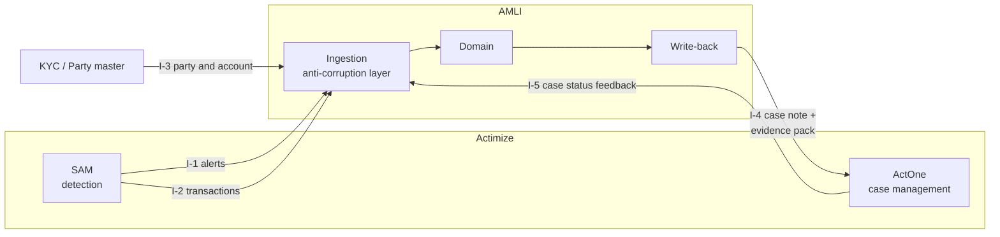
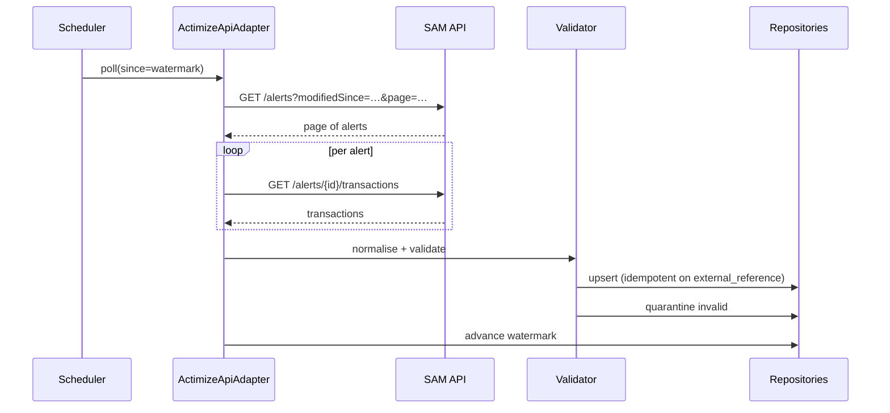

# Integration Design

| | |
|---|---|
| **Document ID** | AMLI-INT-001 |
| **Version** | 0.1 |
| **Status** | Draft — for review |
| **Owner** | Integration Architect |
| **Date** | 18 November 2026 |
| **Classification** | Internal |

---

## 1. Integration posture

Per ADR-013: **Actimize SAM remains the authoritative alert source and ActOne
remains the case system of record.** We read, we reason, we write a
recommendation back. We never mutate alert or case status in the source.



| ID | Interface | Direction | Mode | Frequency |
|---|---|---|---|---|
| I-1 | Alert feed | Inbound | API pull or file extract | Every 15 min / nightly |
| I-2 | Transaction detail | Inbound | API pull or file extract | On demand per alert / nightly |
| I-3 | Party and account master | Inbound | File extract or CDC | Daily |
| I-4 | Recommendation and evidence pack | Outbound | REST API | Event-driven |
| I-5 | Case status feedback | Inbound | API pull | Hourly |

---

## 2. Ingestion modes

Both modes satisfy the same port contract and pass the same contract test suite
(FR-002). Selection is configuration.

### 2.1 Mode A — API pull (preferred)



- **Watermark** is a high-water timestamp per source system, advanced only after
  a successful commit. A failed batch replays from the previous watermark.
- **Pagination** is cursor-based; the adapter never assumes a stable offset.
- **Back-pressure** — the adapter respects `Retry-After` and halves its page
  size on repeated 429s.

### 2.2 Mode B — scheduled file extract (fallback)

For environments where no API is exposed. The extract lands in a dedicated S3
prefix with SSE-KMS; a manifest declares file count, row count and SHA-256 per
file.

| Control | Rule |
|---|---|
| Manifest required | A delivery without a manifest is not processed |
| Hash verification | Every file's hash is verified before parsing |
| Atomicity | Partial deliveries are held until the manifest is satisfied |
| Idempotency | Re-delivery of a processed manifest is a no-op |
| Late arrival | A file for an already-processed business date is processed as a correction, producing supersession rather than duplication |
| Quarantine | Row-level failures quarantine the row with a reason code; the file still processes |

> **Untrusted input handling.** The extract is a file from another system. It is
> written to its own prefix, parsed by a dedicated reader, and never executed,
> deserialised into arbitrary objects, or used to construct file paths.

---

## 3. Anti-corruption layer

Source field names and semantics stop at the adapter. The domain never sees an
Actimize column name.

```python
# amli/adapters/actimize/mapping.py

ALERT_MAPPING: Final[Mapping[str, str]] = {
    "ALERT_ID":                      "external_reference",
    "SCENARIO_NAME":                 "scenario_code",
    "ALERT_DESCRIPTION":             "description",
    "ACTUAL_VALUES_TEXT":            "triggered_values",
    "RUN_DATE":                      "run_date",
}

PARTY_MAPPING: Final[Mapping[str, str]] = {
    "PARTY_NUMBER":                  "external_reference",
    "PARTY_NAME":                    "legal_name",
    "PARTY_TYPE_DESC":               "party_type",
    "PARTY_DATE_OF_BIRTH":           "date_of_birth",
    "OCCUPATION_DESC":               "occupation",
    "ANNUAL_INCOME_AMOUNT":          "annual_income",
    "STREET_CITY_NAME":              "city",
    "STREET_STATE_CODE":             "state_code",
    "RESIDENCE_COUNTRY_NAME":        "country_code",
}

ACCOUNT_MAPPING: Final[Mapping[str, str]] = {
    "ACCOUNT_NUMBER":                "external_reference",
    "PRODUCT_NAME":                  "product_name",
    "ACCOUNT_OPEN_DATE":             "opened_date",
    "ACCOUNT_STATUS_DESC":           "status",
    "ACCOUNT_CURRENCY_NAME":         "currency",
    "ACCOUNT_REGISTRATION_TYPE_DESC":"registration_type",
}

TRANSACTION_MAPPING: Final[Mapping[str, str]] = {
    "DATE_KEY":                      "event_date",
    "TRANSACTION_REFERENCE_NUMBER":  "external_reference",
    "CURRENCY_AMOUNT":               "amount",
    "TRANSACTION_CDI_DESC":          "direction",
    "PRIMARY_MEDIUM_DESC":           "medium",
    "COUNTRY_NAME":                  "country_code",
}
```

### 3.1 Transformations that are not a simple rename

| Source | Target | Rule |
|---|---|---|
| `TRANSACTION_CDI_DESC` | `direction` | Mapped to the controlled vocabulary `credit` / `debit`. An unmapped value quarantines the row (FR-009) — it is never defaulted |
| `COUNTRY_NAME` | `country_code` | Resolved to ISO 3166-1 alpha-2 via a maintained lookup. Unresolved values quarantine |
| `ANNUAL_INCOME_AMOUNT` | `annual_income` + `income_currency` | Currency is taken from the account or institution default and recorded explicitly; a bare number is never stored |
| `CASE_ID`, `FORM_TYPE_CODE` | `alert.outcome` | **Mapped to `outcome` only.** Never to `label`. See §3.2 |
| `DATE_KEY` | `event_date` + `booked_at` | Business date and booking timestamp are distinct; where the source carries only a date, `booked_at` is set to end-of-day in the institution's timezone and the derivation is recorded |
| Remittance / reference text | `reference_text` | Preserved byte-identical, `reference_text_untrusted = true` (FR-010) |

### 3.2 Outcome mapping — the one that matters

```python
FORM_TYPE_TO_OUTCOME: Final[Mapping[str, AlertOutcome]] = {
    "SARX": AlertOutcome.SAR_FILED,
    "CTR":  AlertOutcome.CTR_FILED,
    "CTRX": AlertOutcome.CTR_FILED,
}

def map_outcome(row: Mapping[str, Any]) -> AlertOutcome | None:
    """Outcome only. This function never produces a label (ADR-010)."""
    form = row.get("FORM_TYPE_CODE")
    if form:
        return FORM_TYPE_TO_OUTCOME.get(form)
    if row.get("CASE_ID"):
        return AlertOutcome.ESCALATED_TO_CASE
    return None
```

**There is deliberately no `map_label`.** A label is produced only by the
adjudication workflow, carries a basis and a confidence, and is written through
a separate service that the ingestion adapter cannot reach. In the supplied
extract this distinction removes 10 of 35 alerts from the positive class.

---

## 4. I-4 — write-back to ActOne

### 4.1 Contract

```http
POST /actone/api/v2/cases/{caseExternalRef}/notes
Idempotency-Key: amli-rec-{recommendationId}
Content-Type: application/json
```

```json
{
  "noteType": "AI_RECOMMENDATION",
  "author": "AML Alert Investigator",
  "summary": "Recommendation: close, no further action",
  "body": "…reasoning…",
  "attributes": {
    "amliRecommendationId": "0192f3b2-…",
    "amliRunId": "0192f3a9-…",
    "disposition": "close_no_further_action",
    "groundedness": "1.00",
    "ruleId": "AML-STR-CCE-INN-A-D01-DST",
    "ruleSource": "Actimize AML SAM 8.5.0 Solution Guide p.509",
    "decidedBy": "a.analyst@bank.example",
    "decisionOutcome": "accept_recommendation"
  },
  "attachments": [
    { "name": "evidence-pack.pdf", "contentHash": "3c9e…", "mediaType": "application/pdf" }
  ]
}
```

### 4.2 What the adapter cannot do

The service account used for write-back is provisioned with **note creation
only**. It holds no permission to change case status, close an alert, reassign
ownership or amend a party. This is verified by a contract test that asserts a
status-mutation attempt returns 403 from ActOne (FR-075).

```python
class ActOneAdapter:
    """Write-back only. No status mutation capability exists on this class."""

    def post_recommendation(self, case_ref: str, pack: EvidencePack,
                            idempotency_key: str) -> DeliveryResult: ...

    # Deliberately absent: close_case, update_status, assign_owner,
    # file_report. Adding one requires ADR-013 to be superseded.
```

### 4.3 Delivery guarantees

| Property | Mechanism |
|---|---|
| At-least-once | Outbox table plus relay; the domain write and the delivery event commit together |
| Idempotent | `Idempotency-Key` derived deterministically from `recommendationId` |
| Ordered per case | Single-threaded per case key; different cases proceed in parallel |
| Durable on failure | Failed deliveries retain the full payload and surface in an operator queue (FR-076) |
| Bounded retries | 5 attempts with exponential backoff and full jitter, then dead-letter and a P2 alert |
| Reconcilable | A daily job compares recommendations marked delivered against ActOne notes and reports divergence |

---

## 5. I-5 — case status feedback

ActOne remains authoritative for case status, so we read it back rather than
assume our write succeeded in changing anything.

| Field read | Used for |
|---|---|
| Case status and closure date | Populating `alert.outcome`; measuring cycle time |
| Final disposition recorded by the investigator | Comparison against our recommendation — the override signal |
| Report filing record | `outcome = sar_filed` or `ctr_filed`, **never a label** |

Divergence between our stored case state and ActOne's is reported, not silently
corrected. A reconciliation report runs daily and a divergence above threshold
is a P2 (RISK-009).

---

## 6. Resilience

| Failure | Behaviour |
|---|---|
| SAM unavailable | Ingestion pauses at the watermark; alerts accumulate at source; operator alert after one missed cycle |
| SAM returns malformed data | Row quarantined with a reason code; the batch continues; daily digest to the data steward |
| ActOne unavailable | Deliveries queue in the outbox; recommendations remain available in the workspace; no work is lost |
| ActOne rejects a note | Dead-letter after bounded retries; operator queue; payload retained |
| KYC extract late | Investigation proceeds with the last known party version, and the run records which version was used; if the party is unknown, disposition is `insufficient_information` |
| Duplicate alert from source | Idempotent upsert on `external_reference`; no second run |
| Clock skew between systems | All comparisons use our ingestion timestamp, never the source's, for watermarking |

---

## 7. Security of the integration

| Control | Applied to |
|---|---|
| Mutual TLS or private connectivity | I-1, I-2, I-4, I-5 |
| Least-privilege service accounts, rotated | All interfaces |
| Schema validation before any persistence | I-1, I-2, I-3 |
| No executable or deserialisable content accepted | I-1, I-2, I-3 |
| Payload size limits and parser hardening | File extract reader |
| Egress classification check before I-4 | Write-back body is C3 and goes only to ActOne |
| Full request/response audit, excluding payload bodies | All interfaces |

---

## 8. Replaceability

The adapters exist to make the detection source replaceable (NFR-077). A second
implementation must satisfy the same port and pass the same contract tests:

```python
# tests/contract/test_alert_source_contract.py
@pytest.mark.parametrize("source", [actimize_api(), file_extract(), fake_source()])
def test_alert_source_contract(source: AlertSource):
    """Every adapter honours the same guarantees."""
    assert_idempotent_on_replay(source)
    assert_quarantines_invalid_rows(source)
    assert_preserves_reference_text_bytes(source)
    assert_never_produces_a_label(source)      # ADR-010
    assert_tags_institution_and_jurisdiction(source)
    assert_advances_watermark_only_after_commit(source)
```

`assert_never_produces_a_label` is the contract test that keeps the label
discipline true across every present and future adapter.
