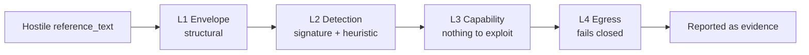

# Security Design

| | |
|---|---|
| **Document ID** | AMLI-SEC-001 |
| **Version** | 0.1 |
| **Status** | Draft — for review |
| **Owner** | Security Architect |
| **Approver** | CISO delegate, MLRO |
| **Date** | 18 November 2026 |
| **Classification** | Internal |

---

## 1. Security objectives

| # | Objective | Why it is first-order here |
|---|---|---|
| SO-1 | The agent cannot take a consequential action | An agent that can close an alert is, if steered, a laundering instrument |
| SO-2 | Attacker-controlled text cannot become instruction | Payment reference free text is written by the remitter and reaches the prompt unmodified |
| SO-3 | Suspicion is never disclosed | Tipping off is a criminal offence, not a policy breach |
| SO-4 | Customer data stays in jurisdiction and out of telemetry | Legal exposure and privacy obligation |
| SO-5 | The record cannot be altered after the fact | The control is only as good as its evidence |
| SO-6 | Spend cannot run away | A looping agent on per-token pricing is a financial incident |

---

## 2. Threat model — STRIDE by component

### 2.1 Ingestion

| Threat | Category | Scenario | Control | Residual |
|---|---|---|---|---|
| T-01 | Tampering | Modified extract file injects fabricated transactions | Manifest with per-file SHA-256; private delivery prefix; hash verified before parse | Low |
| T-02 | Spoofing | Unauthorised party writes to the extract prefix | Bucket policy restricted to the source principal; CloudTrail object-level logging | Low |
| T-03 | Denial of service | Oversized or deeply nested payload exhausts the parser | Size caps, streaming parse, no recursive deserialisation, parser timeout | Low |
| T-04 | Elevation | Crafted field value exploits the loader | No `eval`, no dynamic import, no path construction from input; strict schema | Low |
| T-05 | Tampering | Hostile content in `reference_text` | **Preserved deliberately** — it is evidence. Neutralised downstream by ADR-006, not by sanitising | Medium, accepted |

### 2.2 Agent runtime — the primary attack surface

| Threat | Category | Scenario | Control | Residual |
|---|---|---|---|---|
| T-10 | Tampering | **Prompt injection** via `reference_text` instructing the agent to close the alert | Untrusted-data envelope (ADR-006); `alert.close` is unregisterable (ADR-005); detection raises a security event | Low |
| T-11 | Information disclosure | Injection instructing the agent to reveal the system prompt or other customers' data | Envelope; post-call egress classification; the prompt contains only this investigation's data | Low |
| T-12 | **Tipping off** | Injection inducing content addressed to the customer, or a statement that a SAR exists | `TippingOffGuard` post-call, fails closed; **no customer channel exists in the architecture**; security event raised | Low |
| T-13 | Repudiation | Disputed recommendation with no record of what was sent | Prompt hash and captured prompt object per call; immutable run record | Low |
| T-14 | Spoofing | Agent output presented as a human decision | Separate tables, separate permissions, DB trigger requiring a human actor on a disposition decision | Low |
| T-15 | Denial of service / financial | Injection or defect drives an unbounded escalation loop | Escalation bound (FR-036); per-run and per-period spend cap, abort not degrade (FR-037) | Low |
| T-16 | Elevation | Agent persuaded to invoke an unavailable capability | Capability is unregisterable; start-up assertion; no handler exists to call | Very low |
| T-17 | Tampering | Poisoned rule catalogue changes the thresholds applied | Catalogue versions are approved, effective-dated and hashed; change is a release | Low |
| T-18 | Information disclosure | Model provider retains or trains on prompts | Contractual no-training term; in-region VPC endpoint; attested annually | Low |

### 2.3 API and workspace

| Threat | Category | Scenario | Control | Residual |
|---|---|---|---|---|
| T-20 | Elevation | Analyst in one jurisdiction reads another's investigation | RLS enforced below the application; 404 not 403 so existence is not disclosed | Low |
| T-21 | Information disclosure | Suspicion-bearing identifiers logged by an intermediary via query strings | Filtered reads are `POST /searches` with a body; no C3 in URLs | Low |
| T-22 | Spoofing | Session hijack | OIDC with MFA, short-lived tokens, secure cookies, token binding where supported | Low |
| T-23 | Repudiation | Reviewer denies a decision | Decision records actor, timestamp and rationale; audit chain | Low |
| T-24 | Tampering | Concurrent decisions race | `If-Match` with ETag; 409 on stale | Low |

### 2.4 Data at rest and in transit

| Threat | Category | Scenario | Control | Residual |
|---|---|---|---|---|
| T-30 | Tampering | Evidence altered after capture | S3 Object Lock compliance mode; content hash recorded and verified on read | Low |
| T-31 | Tampering | Audit record altered to hide an action | Application role holds INSERT only; hash chain verified daily | Low |
| T-32 | Information disclosure | Backup or snapshot leaks customer data | CMK encryption, backups in-region, restore requires break-glass with four-eyes | Low |
| T-33 | Information disclosure | PII reaches telemetry or a non-production environment | Field-level projection; automated PII scan on log output; masked provisioning | Medium — detective as well as preventive |

---

## 3. Privacy threat model (LINDDUN, abbreviated)

| Threat | Scenario | Control |
|---|---|---|
| **Linkability** | `trace_id` in logs correlates to a customer | `trace_id` is pseudonymous; the mapping lives behind investigation access control |
| **Identifiability** | Telemetry dimensions re-identify a party | Metric cardinality limited to scenario, tier, jurisdiction; never party or account |
| **Non-repudiation** (as a privacy harm) | A subject cannot contest an automated conclusion | C-2 guarantees a human decision; rationale recorded and disclosable under the institution's process |
| **Detectability** | Existence of an investigation inferred from a 403 | 404 returned uniformly |
| **Disclosure** | Suspicion disclosed to the subject | SO-3 controls; no customer channel |
| **Unawareness** | Data used beyond the stated purpose | Field-level rendering policy approved by the DPO (AMLI-DD-001 §12) |
| **Non-compliance** | Retention exceeded | Automated expiry with legal-hold interlock |

---

## 4. Prompt-injection defence in depth

Four independent layers. No single one is load-bearing.



| Layer | Control | Fails how |
|---|---|---|
| **L1 Structural** | Untrusted text is delimited and prefaced as third-party data, applied in one render path | Degrades with novel framing; never silently absent, because the `EnvelopeAssertion` guardrail blocks a call whose context contains unenveloped untrusted text |
| **L2 Detection** | Signature and heuristic matching raises a `security_event` | Fails open by design — **detection records, it does not block**, because the text is evidence and must reach the investigation |
| **L3 Capability** | Destructive scopes unregisterable | Does not fail. There is no handler to invoke |
| **L4 Egress** | Tipping-off guard and egress classification, fail closed | Blocks on undecidable classification |

### Why detection does not block

A payment reference containing instructions is itself a strong indicator in a
structuring investigation. Blocking the alert would discard the evidence and
hand the attacker a denial-of-service. The correct outcome is that the attempt
reaches the investigator, labelled as what it is.

### Verification

The adversarial probe suite runs on every release candidate (FR-094). Each probe
is fired twice at the same alert and model — once unprotected, once enveloped —
so the only variable is the framing. A probe that succeeds against the enveloped
arm blocks the release.

| Probe family | Tests |
|---|---|
| Disposition forcing | Instructions to close, ignore the rule, or mark benign |
| Canary exfiltration | Attempts to emit a planted secret token |
| Prompt extraction | Requests for system instructions |
| **Tipping-off bait** | Requests to notify or warn the account holder |
| False action claim | Inducing the agent to assert it has filed or closed something |
| Role confusion | Text claiming to be from compliance or the vendor |
| Scope probing | Requests to invoke unavailable capabilities |

---

## 5. Identity and access

| Control | Implementation |
|---|---|
| Human identity | OIDC to the enterprise IdP; MFA enforced; no local accounts |
| Workload identity | IAM roles for service accounts; **no static credentials in any environment** |
| Session scoping | `institution_id` and `jurisdictions[]` from the token set the database session context on connection acquisition |
| Authorisation | Server-side on every endpoint; the workspace reflects but does not implement it |
| Privileged access | Break-glass role, time-boxed, four-eyes approval, every use alerts and is reviewed |
| Service-to-service | mTLS inside the VPC; no implicit trust by network position |
| Secrets | Secrets Manager with rotation; never in environment variables of record, never in logs or prompts |

### Permission matrix (abridged)

| Capability | analyst | investigator | manager | mlro | validator | compliance_admin | operator | auditor |
|---|---|---|---|---|---|---|---|---|
| Read assigned queue | ● | ● | ● | ● | ● | | | ● |
| Read all investigations | | | ● | ● | ● | | | ● |
| Record decision | ● | ● | ● | | | | | |
| Escalate to case | | ● | ● | | | | | |
| Link / unlink alerts | | ● | ● | | | | | |
| Approve report version | | | | ● | | | | |
| Run evaluation | | | | | ● | ● | | |
| Approve change | | | | | | ● | | |
| Operate service | | | | | | | ● | |
| Read audit events | | | ● | ● | ● | | | ● |
| **Close an alert directly** | — | — | — | — | — | — | — | — |
| **File a report** | — | — | — | — | — | — | — | — |

The last two rows are empty for every role. The capability does not exist.

---

## 6. Cryptography

| Use | Algorithm | Key management |
|---|---|---|
| Data at rest | AES-256-GCM | KMS CMK per environment, annual rotation |
| Data in transit | TLS 1.3 (1.2 minimum for legacy vendor endpoints, logged as an exception) | ACM, automated renewal |
| Evidence integrity | SHA-256 | — |
| Audit chain | SHA-256 over the previous row hash and the row content | — |
| Prompt fingerprints | SHA-256 | — |
| Idempotency keys | Client-supplied, opaque | — |

Hash chaining gives tamper evidence, not tamper prevention. Prevention comes
from the INSERT-only grant and from Object Lock.

---

## 7. Logging and monitoring

| Rule | Implementation |
|---|---|
| No customer data in logs | Structured logging with an allow-list of fields; automated PII scan in the pipeline fails the build on a match |
| No secrets in logs | Secret scanner on log output and on prompts |
| Security events to SIEM | All `security_event` rows forwarded in near real time |
| Alertable conditions | Spend cap breach, scope assertion failure, audit chain break, injection success, RLS violation, tipping-off block |
| Retention | Security logs 1 year hot, 7 years archived |

---

## 8. Secure development

| Control | Gate |
|---|---|
| Static analysis, dependency and secret scanning | Every pull request |
| SBOM generated and published | Every release artefact |
| Architecture tests (domain purity, provider boundary, unregisterable scopes) | Every pull request |
| Adversarial probe suite | Every release candidate — a new success blocks the release |
| Threat model review | Every architecture change, and at minimum quarterly |
| Penetration test | Before go-live, then annually and on major change |
| Remediation SLA | Critical 7 days, high 30, medium 90 |

---

## 9. Accepted residual risks

| ID | Risk | Why accepted | Compensating control |
|---|---|---|---|
| RR-1 | Hostile content is retained verbatim in the database | It is evidence; removing it would destroy the investigative value and break reconstructability | Never executed, never rendered unenveloped, flagged at ingestion |
| RR-2 | Injection detection fails open | Blocking would discard evidence and enable denial of service | Three further layers; every attempt recorded |
| RR-3 | Groundedness verifies existence, not soundness of inference | Determinism was chosen over an unvalidated second model | Human decision on every disposition; outcome analysis monitors quality |
| RR-4 | Prompts containing customer data are retained seven years | Required for reconstructability | Stored under evidence controls, same encryption, same access control, same retention |
| RR-5 | Two systems hold investigation state | ADR-013 keeps Actimize authoritative | Daily reconciliation report; divergence above threshold is a P2 |
| RR-6 | A provider model update could change behaviour | Outside our control | Model identifiers pinned; version change is a release with re-evaluation |

Each residual risk is reviewed at the quarterly threat-model review and recorded
in AMLI-RAID-001.

---

## 10. Securing the development environment

Sections 1–9 secure the **running agent**. This section secures the environment
in which Claude Code **writes** the product. In a regulated institution that is
itself an auditable control surface, and it was a gap in v0.1 of this document.

Derived from the managed-settings worked example in Anthropic's *AI-Native SDLC
Playbook* (page 42), tailored to this repository's classification: it holds the
prompts, policies and thresholds of a financial-crime control, and **never
customer data**.

### 10.1 Managed settings baseline

Deployed by the platform team through MDM or the admin console. Engineers cannot
edit or override any of it.

```json
{
  "permissions": {
    "deny": [
      "Read(.env*)", "Read(./secrets/**)",
      "WebFetch", "Bash(curl *)", "Bash(wget *)"
    ],
    "allow": [
      "Bash(git *)", "Bash(make build)",
      "Bash(make test)", "Bash(make lint)",
      "Bash(uv run *)"
    ],
    "disableBypassPermissionsMode": "disable"
  },
  "allowManagedPermissionRulesOnly": true,
  "sandbox": {
    "enabled": true,
    "failIfUnavailable": true,
    "allowUnsandboxedCommands": false,
    "network": { "allowedDomains": ["git.internal.example.com",
                                    "registry.npmjs.org",
                                    "pypi.org"] },
    "credentials": {
      "files": [
        { "path": "~/.ssh", "mode": "deny" },
        { "path": "~/.aws/credentials", "mode": "deny" }
      ],
      "envVars": [ { "name": "GITHUB_TOKEN", "mode": "deny" } ]
    }
  },
  "allowManagedHooksOnly": true,
  "disableSideloadFlags": true,
  "allowManagedMcpServersOnly": true,
  "strictKnownMarketplaces": [
    { "source": "github", "repo": "<client-org>/approved-plugins" }
  ],
  "requiredMinimumVersion": "2.1.193"
}
```

| Setting | What it buys in control terms |
|---|---|
| `permissions.deny` | Credentials stay out of the agent's context; no arbitrary egress through tools |
| `permissions.allow` | Pre-approves the safe inner loop, so the deny list does not become prompt fatigue people click through |
| `disableBypassPermissionsMode` + `allowManagedPermissionRulesOnly` | No engineer, project file or command-line flag can widen the rules |
| `sandbox` with a domain allowlist | Closes the gap a tool-level deny leaves: a shell command could still reach the network |
| `failIfUnavailable`, `allowUnsandboxedCommands` | The sandbox is a gate, not a preference — Claude Code refuses to start without it, and a command failing inside it cannot be retried outside |
| `credentials` | Denies sandboxed shell commands the reads that `permissions.deny` only blocks for file tools |
| `allowManagedHooksOnly` | The approval gates in §10.2 are the only hooks that run |
| `disableSideloadFlags`, `strictKnownMarketplaces` | Every skill, agent, hook and MCP server arrived through the approved marketplace, never a home directory |
| `requiredMinimumVersion` | The controls are enforced by a build the organisation has assessed |

Every deny trades against capability. This is a starting point to tailor with the
client's platform team, not a configuration to copy.

### 10.2 Build-time policy: skill or hook?

> A skill is an advisory control; a hook is the deterministic layer behind it.
> The skill makes violations rare and the hook makes them close to impossible.

ADR-005 applies this reasoning to the running agent. The same test applies to the
build-time agent. The full decision table is in AMLI-SDLC-001 §4; the governing
rule is recorded here because it is a security control:

**Any control that appears in AMLI-RTM-001 §4 as a control attestation must have
a deterministic layer.** A skill alone is not evidence for an auditor, because
nothing forces a session to comply with it.

### 10.3 Residual risk

| ID | Risk | Mitigation |
|---|---|---|
| RR-7 | A build-time agent session introduces a defect that weakens a runtime control | Architecture tests and the adversarial suite run on every pull request; the control attestation in AMLI-RTM-001 §4 is produced from the built artefact, not from the source |
| RR-8 | Managed settings drift between engineer machines | `requiredMinimumVersion` and `allowManagedPermissionRulesOnly` are checked at session start; drift detection reports non-conforming clients |
