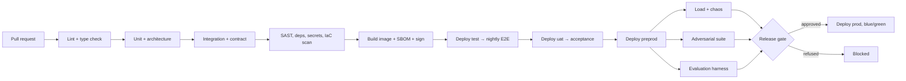

# Deployment and Operations

| | |
|---|---|
| **Document ID** | AMLI-OPS-001 |
| **Version** | 0.1 |
| **Status** | Draft — for review |
| **Owner** | SRE Lead |
| **Date** | 18 November 2026 |
| **Classification** | Internal |

---

## 1. Environments

| Env | Purpose | Data | Account | Scale | Provider |
|---|---|---|---|---|---|
| `dev` | Development | Synthetic | Shared non-prod | Minimal | Stubbed, live on demand |
| `test` | Automated test | Synthetic | Shared non-prod | Minimal | Stubbed |
| `uat` | Business acceptance, analyst training | Masked | Dedicated non-prod | 10% of prod | Live, pinned |
| `preprod` | Release rehearsal, load, adversarial | Masked, prod-scale | Dedicated | 100% of prod | Live, pinned |
| `prod` | Live | Production | Dedicated, isolated | Full | Live, pinned |

Separate AWS accounts for production. No human has standing write access to the
production account; changes arrive through the pipeline, and break-glass is
time-boxed with four-eyes approval and alerts on every use.

---

## 2. Infrastructure as code

| Rule | Detail |
|---|---|
| Everything in Terraform | Network, compute, data, IAM, observability, alarms |
| No manual production change | Drift detection runs hourly; drift raises a P3 and is reverted, not adopted |
| Module reuse across environments | Differences are variables, never forked modules |
| State | S3 backend with DynamoDB locking, per environment, encrypted with CMK |
| Policy as code | `tfsec` and `checkov` in the pipeline; a failing policy blocks the plan |
| Secrets | Never in Terraform state; created empty and populated out of band |

---

## 3. CI/CD

| Property | Detail |
|---|---|
| Authentication to AWS | GitHub OIDC, no static credentials |
| Image provenance | Signed with Cosign; the cluster refuses unsigned images |
| Immutable artefacts | The same image digest is promoted through every environment; never rebuilt per environment |
| Database migrations | Versioned, forward-only, backward-compatible for one release so blue/green can run both versions |
| Release gate | Load, chaos, adversarial and evaluation results plus current MRM approval |

### The release gate is blocking

A release reaching `prod` requires, for that specific release:

1. Adversarial suite clean on the enveloped arm.
2. Evaluation harness above every floor, with confidence intervals reported.
3. MRM approval current for this release, not a previous one.
4. Rollback rehearsed in `preprod`.

---

## 4. Deployment strategy

| Component | Strategy | Health gate |
|---|---|---|
| Investigation API and workspace | Blue/green with ALB weighting | Synthetic transaction + error-rate check over 10 min |
| Agent runtime workers | Rolling, one task at a time, drain in flight | Queue depth stable; no rise in `failed` runs |
| Ingestion | Rolling; watermark makes it safe | Lag returns to baseline |
| Database migrations | Expand → migrate → contract across two releases | Migration smoke test |

### Rollback

| Property | Target |
|---|---|
| Time to roll back | ≤ 15 min (NFR-067) |
| Mechanism | Re-point blue/green to the previous target group; redeploy previous image digest |
| Database | Forward-only migrations are backward-compatible for one release, so a rollback needs no schema reversal |
| Agent configuration | A release is a set of asset versions; rollback reverts the whole set together, never partially |
| Rehearsal | Every release rehearses rollback in `preprod`; an unrehearsed rollback path is not a rollback path |

---

## 5. Runbooks

Each alert in AMLI-OBS-001 §7 maps to one. The two that matter most:

### RB-01 — Disposition recorded without a human decision (P1)

1. **Suspend processing immediately** — pause the agent runtime queues. The
   reviewer workspace stays up; investigators revert to manual triage.
2. Identify affected dispositions: query `decision` joined to `actor` for any
   non-human actor on a disposition outcome.
3. Notify MLRO, Head of Financial Crime Technology and Model Risk within 30 min.
4. Preserve evidence: snapshot the relevant `ai_run`, `decision` and
   `audit_event` rows before any remediation.
5. Root cause. This condition is prevented by a database trigger, so its
   occurrence means either the trigger was removed or a write bypassed the
   application — both of which are security incidents, not defects.
6. Do not resume until the control is restored and independently verified.

### RB-03 — Spend cap breached (P1)

1. Confirm from `amli_budget_utilisation_ratio` and the `budget.exceeded` event
   whether this is volume, an escalation loop, or a pricing change.
2. If an escalation loop: pause the runtime, inspect the affected runs for a
   repeated escalation on one alert, and check the escalation bound
   configuration.
3. If volume: confirm with the Investigations Manager whether a backfill or a
   detection tuning change is in progress upstream.
4. Raise the cap only with the service owner's approval, recorded.
5. Resume and monitor for one full cycle.

Remaining runbooks RB-02, RB-04 to RB-12 follow the same shape and are
maintained alongside the alert definitions.

---

## 6. Business continuity and disaster recovery

| Objective | Target | Mechanism |
|---|---|---|
| RTO — reviewer service | 4 h | Multi-AZ; redeploy from IaC into a second AZ set |
| RTO — batch investigation | 24 h | Batch is restartable from the watermark |
| RPO — all data | 15 min | Aurora continuous backup with PITR; S3 versioning and replication |
| Backup retention | 35 days PITR, monthly snapshots for 7 years | Automated, cross-region copy |
| Restore rehearsal | Quarterly, full restore into an isolated account, timed and evidenced | Required by audit |

### Degraded modes

| Scenario | Degraded mode | Investigator impact |
|---|---|---|
| Bedrock unavailable | Runs fail cleanly; alerts route to the manual queue | Manual triage, as today |
| Database unavailable | Full outage; alerts remain in SAM | Manual triage in ActOne |
| Evidence store unavailable | Investigation refuses to start (evidence cannot be captured) | Manual triage |
| ActOne unavailable | Recommendations queue in the outbox; workspace continues | Delayed write-back only |
| Rule catalogue unavailable | `insufficient_information`, reason `catalogue_unavailable` | Manual triage |

**Reversion to manual triage must always be available.** No part of this design
removes the institution's ability to investigate without it — the alerts, the
queue and the evidence all remain in the institution's own systems.

---

## 7. Capacity and cost management

| Control | Detail |
|---|---|
| Autoscaling | Agent runtime scales on SQS queue depth; API on CPU and request count |
| Scaling ceiling | Hard maximum task count, set above measured peak plus 30% |
| Spend cap | Per run and per period; breach aborts work and alerts, never silently continues |
| Cost attribution | Tags by environment, component and institution; `model_call` gives per-alert and per-scenario cost |
| Budget alerts | 50%, 80%, 100% of monthly forecast |
| Reserved capacity | Reviewed quarterly once the load profile is stable |
| Quota management | Bedrock throughput quota tracked as a supplier dependency; increases requested ahead of volume growth (RISK-006) |

---

## 8. Operational calendar

| Activity | Frequency |
|---|---|
| Partition creation (3 months ahead) | Monthly, automated |
| Partition expiry with legal-hold interlock | Monthly, automated, reconciled manually |
| Audit hash-chain verification | Daily, automated |
| Evidence integrity sampling | Weekly, 100 random objects re-hashed |
| Backup restore rehearsal | Quarterly |
| Access review | Quarterly |
| Threat-model review | Quarterly |
| Penetration test | Annually and on major change |
| DR exercise | Annually |
| Rule catalogue rebuild and diff | On source change; verified quarterly |

---

## 9. Support model

| Tier | Responsibility | Hours |
|---|---|---|
| L1 | Platform on-call: triage, runbook execution, escalation | 24×7 |
| L2 | Engineering: defects, data issues, integration failures | Business hours, on-call for P1/P2 |
| L3 | Architecture, Model Risk, Security | Business hours, on-call for P1 |
| Business | Investigations Manager: queue, quality, override patterns | Business hours |

| Severity | Response | Resolution target |
|---|---|---|
| P1 | 15 min | 4 h or documented workaround |
| P2 | 1 h | 1 business day |
| P3 | 1 business day | 5 business days |
| P4 | 5 business days | Next release |

**P1 definition includes correctness, not only availability**: a disposition
without a human decision, an invented citation in production, emitted
customer-facing content, or an audit chain break are each P1 regardless of
whether the service is up.
