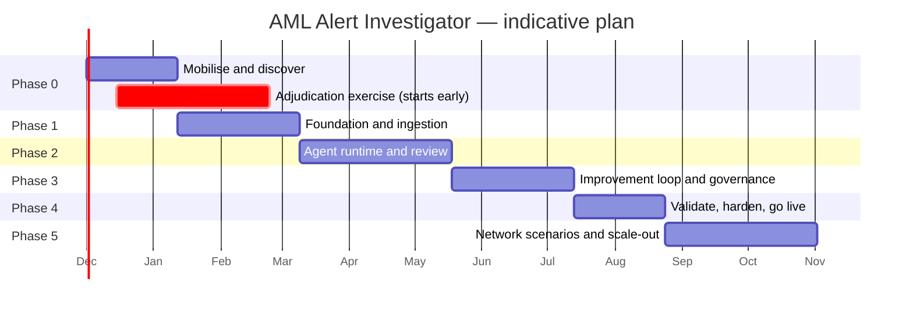
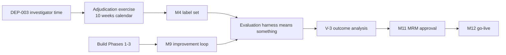

# Delivery Plan

| | |
|---|---|
| **Document ID** | AMLI-PLAN-001 |
| **Version** | 0.1 |
| **Status** | Draft — for review |
| **Owner** | Delivery Lead |
| **Approver** | Head of Financial Crime Technology |
| **Date** | 18 November 2026 |
| **Classification** | Internal |

---

## 1. Shape of the programme

Five phases over approximately **38 weeks** to a production go-live in one
jurisdiction, with two scenarios deferred to a sixth phase.

**The adjudication exercise starts in Phase 0 and runs in parallel.** It is
calendar-bound, not effort-bound, and nothing downstream of validation can
start without it (see §7).

---

## 2. What already exists

Honest accounting of the reference implementation in `aml/`, so the plan
estimates what is left rather than what is impressive.

| Capability | Status | Phase that completes it |
|---|---|---|
| Evidence-gated routing with escalation | **Proven** — measured on a real corpus | 2 (productionise) |
| Deterministic groundedness checking | **Proven** | 2 |
| Untrusted-data envelope, A/B probe harness | **Proven** — defended vs exploited measured | 2 |
| Ungrantable destructive scopes | **Proven** | 2 |
| Versioned rule catalogue with page citations | **Proven** — 28 rules, 4 detection models | 1 |
| Ledger with cost per outcome | **Proven** | 1 |
| Failure clustering, paired sign test, refusing gate | **Proven** | 3 |
| `AI_RUN` as the universal join key | **Partial** — model calls only | 2 |
| Case entity and consolidation | Not built | 2 |
| Evidence capture with hashing and snapshots | Not built | 2 |
| Decision, actor and override records | Not built | 2 |
| Outcome / adjudication / label separation | Not built | 1 |
| Actimize ingestion and write-back adapters | Not built | 1, 2 |
| Reviewer workspace | Not built | 2 |
| Multi-tenancy, RLS, jurisdiction scoping | Not built | 1 |
| Production platform, IaC, CI/CD, observability | Not built | 1 |

Roughly a third of the hard thinking is done and demonstrated. None of the
platform, persistence, integration or human workflow is.

---

## 3. Phases

### Phase 0 — Mobilise and discover (6 weeks)

| Workstream | Deliverables |
|---|---|
| Discovery | Actimize interface confirmation (ASM-001); volume and profile validation (ASM-008); counterparty data availability (ASM-004) |
| Platform | AWS accounts, network, Bedrock access and region approval (ASM-003, DEP-002) |
| Data | **Apply the schema to a live PostgreSQL instance and run the constraint suite (ISS-007)**; confirm partitioning and RLS behaviour |
| Governance | MRM engagement and model registration (DEP-006); DPO review of the rendering policy (DEP-008); legal position on automated decision-making (DEP-007) |
| **Labels** | **Design and begin the adjudication exercise (DEP-003)** — stratification, adjudicator training, tooling, inter-rater pilot |
| Decisions | Resolve ISS-001 — does a human review every close, or only escalations? |
| Method | Agree the artifact chain and **name one source of truth per artifact** (AMLI-SDLC-001 §3, DEP-013); agree the programme leading and lagging indicators (AMLI-SDLC-001 §8) |

**Exit criteria.** Interfaces confirmed; environments reachable; schema applied
and tested; adjudication under way with κ measured on a pilot of 100; ISS-001
decided by the sponsor.

> ISS-001 is listed as a Phase 0 exit because it changes the business case. If a
> human reviews every close, most of the GBP 5.00 saving disappears and the
> value contract must be renegotiated before the build is scoped.

---

### Phase 1 — Foundation and ingestion (8 weeks)

| Workstream | Deliverables |
|---|---|
| Platform | Terraform baseline, three environments, CI/CD with OIDC, image signing, SBOM, secret and dependency scanning, licence scanning (ISS-006) |
| Engineering method | `CLAUDE.md`, the skill library, build-time hooks and `REVIEW.md` as versioned platform deliverables; **managed settings baseline** (AMLI-SEC-001 §10); agent-eval suite gated on configuration change (AMLI-TST-001 §13) |
| Data | Core schema deployed: `institution`, `actor`, `party`, `account`, `transaction`, `alert`, `detection_version`, `policy_version`, `audit_event`. RLS, partition management, retention jobs |
| Ingestion | `AlertSource` port with both adapters; validation, quarantine, watermarking, idempotency; contract test suite |
| Rules | Rule catalogue extraction, versioning and effective-dated resolution |
| Labelling | Outcome / adjudication / label separation with database constraints; adjudication capture tooling |
| Ledger | Model call and outcome recording; cost attribution |
| Observability | SYSTEM and MODEL layers; tracing; log hygiene with the PII scan gate |

**Exit criteria.** A day's alerts ingest end to end in both modes, idempotently,
with quarantine working; the schema enforces label integrity (a CTR cannot
produce a positive label); dashboards show SYSTEM and MODEL; the pipeline blocks
on every security gate; **every build-time control attested in AMLI-RTM-001 §4
has a deterministic layer, not only a skill**.

**Team.** 1 tech lead, 3 backend engineers, 1 data engineer, 1 platform
engineer, 0.5 BA, 0.5 test engineer.

---

### Phase 2 — Agent runtime and human review (10 weeks)

The core of the product.

| Workstream | Deliverables |
|---|---|
| Runtime | Evidence collector with hashing and S3 Object Lock; context renderer with the field projection; envelope; guardrail chain; router with the evidence gate; parser; groundedness checker; `ai_run` spine complete across calls, controls, evidence and security events (ISS-004) |
| Domain | `case`, `case_alert`, `evidence_item`, `finding`, `finding_evidence`, `recommendation`, `decision` with the human-actor trigger |
| API | Investigation API per AMLI-API-002; OIDC, RBAC, RLS session context, idempotency |
| Workspace | Reviewer UI: recommendation, reasoning, findings, evidence in one interaction; accept / override / request information; structured override reasons; WCAG 2.2 AA |
| Integration | ActOne write-back with outbox and idempotency; case status feedback; reconciliation report |
| Security | Adversarial probe suite in the pipeline as a release gate |
| Observability | AGENT and TRANSACTION layers; the zero-autonomous-disposition control report |

**Exit criteria.** An alert flows from SAM to a recommendation to a human
decision to an ActOne note; the adversarial suite is clean on the enveloped arm;
`amli_dispositions_without_human_decision` is zero and demonstrably so; UAT
sign-off from the Investigations Manager.

**Team.** Phase 1 team plus 2 frontend engineers, 1 integration engineer, 1
security engineer, full-time test engineer.

---

### Phase 3 — Improvement loop and governance (8 weeks)

| Workstream | Deliverables |
|---|---|
| Evaluation | Harness against frozen dataset versions; 3-repeat measurement; paired statistical test; confidence intervals |
| Mining | Failure and override clustering on alert-observable features; proposal generation with evidence |
| Gate | Value-contract gate that refuses on recall; change approval linking evaluation, release and approver |
| Registry | `ai_asset`, `ai_asset_version`, `release`, `release_component`, `deployment`; `ai_run.deployment_id` becomes mandatory |
| Reporting | Narrative drafting (draft only); report versioning |
| Governance | Monthly model performance pack; deviation banding; fairness testing; control attestations |
| Observability | VALUE layer; full reporting cadence; operational control bands with the escalating-autonomy gradient (AMLI-OBS-001 §9) |
| Method | Every production incident becomes a permanent eval (AMLI-TST-001 §13.2) |

**Exit criteria.** A change can be proposed from production evidence, evaluated,
refused for recall and approved for a genuine improvement, with the whole chain
queryable; the monthly MRM pack is produced automatically.

**Team.** Phase 2 team minus 1 frontend engineer, plus 1 data scientist.

---

### Phase 4 — Validate, harden and go live (6 weeks)

| Workstream | Deliverables |
|---|---|
| Validation | V-1 to V-11 of AMLI-MRM-001 completed; validation report and model approval |
| Performance | Load to peak, soak 72 h, stress to 150%, chaos, failover |
| Security | External penetration test, remediation to closure |
| Operations | Runbooks rehearsed by people who did not write them; DR restore rehearsal; on-call established |
| Business | Analyst training; shadow running; cutover plan |
| Go-live | Phased ramp: shadow → 10% of alerts → 50% → 100% |

**Exit criteria.** MRM approval signed; no open S1 or S2; recall and groundedness
floors met with stated confidence intervals; rollback rehearsed; shadow running
shows agreement within band.

> **Shadow running is not optional.** For at least four weeks the agent
> investigates alerts that investigators are also triaging manually, and the two
> are compared. It is the only way to measure real-world recall before the
> recommendation starts influencing decisions.

---

### Phase 5 — Network scenarios and scale-out (10 weeks)

| Workstream | Deliverables |
|---|---|
| Data | `party_relationship`, `transaction_participant`, `party_account_role`, `risk_assessment`; identity resolution for unresolved counterparties |
| Scenarios | SAS10602 and SAS10012 built, adjudicated and validated separately |
| Graph | Read-only graph projection for network queries |
| Scale-out | Additional jurisdictions; per-jurisdiction policy and legal review |

Gated on DEP-004. If counterparty data is unavailable, these scenarios leave
scope rather than being approximated.

---

## 4. Team and effort

| Role | P0 | P1 | P2 | P3 | P4 | P5 |
|---|---|---|---|---|---|---|
| Delivery lead | 0.5 | 0.5 | 1 | 1 | 1 | 0.5 |
| Solution architect | 1 | 1 | 1 | 0.5 | 0.5 | 0.5 |
| Tech lead | 0.5 | 1 | 1 | 1 | 1 | 1 |
| Backend engineer | — | 3 | 4 | 3 | 2 | 3 |
| Frontend engineer | — | — | 2 | 1 | 1 | — |
| Data engineer / architect | 1 | 1 | 1 | 1 | 0.5 | 2 |
| Platform / SRE | 0.5 | 1 | 1 | 1 | 1.5 | 1 |
| Security engineer | 0.5 | 0.5 | 1 | 0.5 | 1 | 0.5 |
| Test engineer | — | 0.5 | 1 | 1 | 1.5 | 1 |
| Data scientist | — | — | — | 1 | 0.5 | 0.5 |
| Business analyst | 1 | 0.5 | 0.5 | 0.5 | 0.5 | 0.5 |
| Model risk (client) | 0.2 | 0.2 | 0.2 | 0.5 | 1 | 0.5 |
| Investigator SME (client) | 0.5 | 0.5 | 1 | 0.5 | 1 | 0.5 |
| **FTE total** | **5.7** | **9.7** | **14.7** | **12.5** | **13** | **11.5** |
| **Duration (weeks)** | 6 | 8 | 10 | 8 | 6 | 10 |
| **Person-weeks** | 34 | 78 | 147 | 100 | 78 | 115 |

**Phases 0–4: approximately 437 person-weeks** to production in one
jurisdiction. Phase 5 adds roughly 115.

Separately, **DEP-003 requires about 25 person-days of experienced investigator
time** for adjudication. It is the scarcest resource in the plan and the one
most often assumed rather than booked.

---

## 5. Milestones

| # | Milestone | Week | Evidence |
|---|---|---|---|
| M1 | Mobilised; interfaces and environments confirmed | 6 | Discovery report; connectivity proven |
| M2 | Schema live and enforcing label integrity | 10 | Constraint suite passing on a real instance |
| M3 | Ingestion working end to end, both modes | 14 | A day's alerts, idempotent, quarantine working |
| M4 | **Adjudicated label set delivered** | 16 | ≥ 1,000 alerts, κ ≥ 0.6 reported |
| M5 | First recommendation with cited evidence in a non-production environment | 20 | E2E walkthrough |
| M6 | Human decision recorded and written back to ActOne | 24 | E2E walkthrough; zero-autonomous control report |
| M7 | Adversarial suite gating the pipeline | 26 | Release blocked by an injected regression, demonstrably |
| M8 | UAT signed off | 28 | Investigations Manager sign-off |
| M9 | Improvement loop closes: proposal evaluated, one refused, one approved | 34 | Change approval chain queryable |
| M10 | Shadow running begins | 36 | Agreement reporting live |
| M11 | **MRM validation approved** | 40 | Signed validation report |
| M12 | **Production go-live, ramped to 100%** | 44 | Control attestations green for one full month |

---

## 6. Governance

Programme health is measured with the leading and lagging indicators in
AMLI-SDLC-001 §8. They are deliberately separate from the product's value
contract and must never be conflated with it: shipping faster is not the
objective, and would be a poor trade against recall.

| Forum | Frequency | Attendees | Decisions |
|---|---|---|---|
| Daily stand-up | Daily | Delivery team | Impediments |
| Design authority | Fortnightly | Architects, tech lead, security, data | ADRs, schema changes, interface contracts |
| Delivery forum | Weekly | Delivery lead, leads, client PO | Progress, RAID, scope |
| Model risk forum | Monthly | MRM, model owner, data scientist | Validation progress, deviations, metric floors |
| Steering group | Monthly | Sponsor, MLRO, CISO delegate, DPO, delivery lead | Phase gates, funding, risks ≥ 15 |
| Phase gate review | Per phase | Steering group | Exit criteria met or not |

### Definition of Done

A story is done when: code reviewed; unit, integration and contract tests green;
architecture tests green; requirement traced in AMLI-RTM-001; observability
emitted; runbook updated where it introduces an alert; documentation updated;
deployed to `test` through the pipeline; no new critical or high vulnerability;
and, where it touches a control, the control test exists and passes.

---

## 7. The critical path is labels, not code

Stated plainly because it is the most common way programmes of this kind slip
without anyone noticing until the end.

The build can be compressed by adding engineers. **Adjudication cannot.** It
needs experienced investigators, reading alerts carefully, twice, independently,
and that takes the calendar time it takes.

If DEP-003 is not secured in Phase 0, the programme will reach a
feature-complete system that cannot be validated and therefore cannot go live.
That is RISK-001, it carries the highest exposure on the log, and it is the one
item the sponsor should be asked to resolve first.

---

## 8. Phase gate criteria summary

| Gate | Must be true to proceed |
|---|---|
| **P0 → P1** | Interfaces confirmed; environments reachable; schema applied and tested on a real instance; adjudication started with a measured pilot κ; ISS-001 decided |
| **P1 → P2** | Ingestion proven in both modes; label integrity enforced by constraint; SYSTEM and MODEL telemetry live; pipeline security gates blocking |
| **P2 → P3** | End-to-end flow proven; adversarial suite clean and gating; zero autonomous dispositions demonstrable; UAT signed off |
| **P3 → P4** | Gate refuses a real recall-losing proposal; change approval chain queryable; monthly MRM pack automated |
| **P4 → Live** | MRM approval signed for this release; floors met with confidence intervals; pentest remediated; rollback rehearsed; four weeks of shadow running within band |
| **Live → P5** | One month of green control attestations; DEP-004 satisfied |

---

## 9. Immediate next steps

| # | Action | Owner | By |
|---|---|---|---|
| 1 | Resolve ISS-001 — human review on every close, or escalations only | Product Owner with MLRO | Before Phase 0 ends |
| 2 | **Secure DEP-003: investigator time for adjudication** | Sponsor | Before Phase 0 ends |
| 3 | Confirm Actimize interface availability (ASM-001) | Integration Architect | Phase 0 week 2 |
| 4 | Confirm Bedrock region approval for customer data (ASM-003) | Security Architect | Phase 0 week 2 |
| 5 | Apply the schema to a live PostgreSQL instance and run the constraint suite (ISS-007) | Data Architect | Phase 0 week 3 |
| 6 | Register the model with MRM and agree the materiality tier | Model Risk Lead | Phase 0 week 4 |
| 7 | Baseline these documents and place them under change control | Delivery Lead | Phase 0 week 4 |
