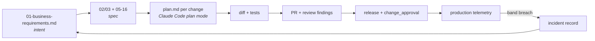

# How We Build It — AI-Native SDLC Method

| | |
|---|---|
| **Document ID** | AMLI-SDLC-001 |
| **Version** | 0.1 |
| **Status** | Draft — for review |
| **Owner** | Engineering Lead |
| **Approver** | Head of Financial Crime Technology |
| **Date** | 23 November 2026 |
| **Classification** | Internal |

Documents 01–23 describe **what** we are building. This one describes **how the
programme itself runs**, adopting the practices in Anthropic's *AI-Native SDLC
Playbook* (Louis Claxton, Anthropic, September 2026) and recording where we
diverge from it and why.

---

## 1. Why this document exists

The design set is conventional in shape: a BRD, an HLD, an LLD, a test strategy.
That shape is correct for a regulated financial-crime programme — it is what the
model risk function, Internal Audit and the supervisor expect to read.

But a conventional document set carries an assumption that no longer holds: that
writing the code is the expensive part, and that heavyweight up-front
documentation is worth it because implementation takes months. When
implementation takes days, **the bottleneck moves to the stages on either side of
it** — planning, review and deploy — and the control model has to move with it.

The playbook's framing is the one we adopt:

> Reviewing each line by hand made sense when a person had written it, but it
> can't keep up once agents write most of the diff.

So: the documents stay, because the obligations are real. What changes is that
each one becomes a **committed artifact that the next stage reads**, rather than a
deliverable that is signed and shelved.

---

## 2. Six stages, our four pillars, and this programme

| Playbook stage | Playbook artifact | Our pillar | This programme |
|---|---|---|---|
| **Plan** | `intent.md` | Builds — Specs | `01-business-requirements.md`, `04-use-cases` |
| **Design** | `spec.md` | Builds — Specs, Context, Skills | `02`–`03`, `05`–`16` |
| **Build** | `plan.md`, diff, tests | Builds — Loops, Graphs | Phase 1–3 of AMLI-PLAN-001 |
| **Test** | evals, feedback loop | Builds — Evaluation; Improves — Harness | `18-test-strategy.md` |
| **Deploy** | PR + findings, gates | Secures; Runs | `20-deployment-and-operations.md` |
| **Maintain** | incident record → new intent | Improves; Runs — Observability | `19-observability`, `17-model-risk` |

The mapping is close enough that it is worth stating the one real difference: the
playbook's six stages describe *building software*; our four pillars describe
*building, running, securing and improving an AI system*. Secures has no
playbook stage of its own because in the playbook security is woven through
Build (hooks), Deploy (review passes, managed settings) and Maintain. For an AML
product the adversarial surface is large enough to justify a pillar of its own.

---

## 3. The artifact chain

The playbook's central idea, and the one we adopt wholesale:

> Every stage commits an artifact the next stage can read. Together, the intent,
> the spec, the plan, the diff and the review findings are the audit trail.

For this programme the chain is:

Two properties matter and both are free once the chain exists:

- **The commit history is the audit trail.** Who asked for what, what the agent
  produced, who approved it — with timestamps, in one place.
- **Traceability is mechanical, not clerical.** AMLI-RTM-001 stops being a
  spreadsheet somebody maintains and becomes a query over commits.

### Source of truth per artifact

The playbook's legacy-systems sidebar is directly applicable, because a bank
already has Jira, a requirements tool with regulatory traceability, and a change
board. It gives three configurations, and the instruction is to **name one system
as the source of truth per artifact**.

Our position, to be confirmed with the client in Phase 0:

| Artifact | Source of truth | Rationale |
|---|---|---|
| Business requirements, NFRs | **Client requirements tool** | It already carries regulatory traceability the auditor accepts |
| Design documents 05–20 | **Repository** | They change with the code and are reviewed with it |
| ADRs | **Repository** | Decisions belong next to what they constrain |
| `plan.md` per change | **Repository** | Produced by plan mode, consumed by PR review |
| Change approvals | **Client change management** | A change board record is a regulatory artefact |
| Incident records | **Client incident tool**, mirrored to the repo as evals | The eval must live with the code it protects |

**Linkage is the minimum bar**: every design document carries its requirements-tool
IDs, and every tool record carries the commit SHA. Raised as `DEP-013`.

---

## 4. Build-time controls: the skill / hook pair

This is the sharpest governance idea in the playbook and it generalises a decision
we had already made in one place:

> A skill is a control, though an advisory one. It makes Claude likely to apply
> the policy while the code is written, and nothing forces a session to comply
> with it. A policy that must always hold needs something deterministic behind
> the skill, such as a hook that blocks the action. **The skill makes violations
> rare and the hook makes them close to impossible.**

ADR-005 is exactly this reasoning applied to the *running agent*: an ungrantable
scope is the deterministic layer behind an instruction. The playbook tells us to
apply the same test to the **build-time agent** — the Claude Code sessions that
write AMLI itself.

For each policy that governs how AMLI is built, we decide: advisory, deterministic,
or both.

| Policy | Skill (advisory) | Hook (deterministic) |
|---|---|---|
| Domain layer imports no SDK or framework | `architecture-standard` | PreToolUse block on edits adding a forbidden import to `amli/domain/**` |
| Money is `numeric`/`Decimal`, never float | `financial-code-standard` | Lint rule in the commit hook |
| Labelling discipline — no label derived from an outcome | `label-integrity` | **Database constraint** (already in AMLI-DDL-001) plus a hook blocking edits that add a `map_label` symbol |
| Ungrantable scopes are never registered | `scope-discipline` | Start-up assertion (already) plus a hook on edits to `scopes.py` |
| Tests may not be weakened during a fix | — | PreToolUse block on edits to `tests/**` during a fix task |
| Secrets never in the diff | `secure-coding` | Secret scan hook pre-commit |
| No direct push to `main` | — | Branch protection |
| Migrations and infra need a change ticket | — | PreToolUse ask-gate on `migrations/**` and `infra/**` |

**The rule we adopt:** a control that appears in AMLI-RTM-001 §4 as a control
attestation must have a deterministic layer. A skill alone is not sufficient
evidence for an auditor, because nothing forces a session to comply with it.

---

## 5. Securing the development environment

The playbook's worked example of managed settings for a regulated enterprise
(page 42) fills a gap in our set: AMLI-SEC-001 secures the **running agent**, but
said nothing about the environment in which Claude Code **writes** AMLI. In a bank
that is itself an auditable control surface.

The baseline is now specified in AMLI-SEC-001 §10 and is a Phase 1 deliverable
owned by the platform team. Summary of what it buys:

| Setting | Control purpose |
|---|---|
| `permissions.deny` on `.env*`, `secrets/**`, `WebFetch`, `curl`, `wget` | Keeps credentials out of the agent's context; blocks arbitrary egress through tools |
| `permissions.allow` on the safe inner loop | Prevents prompt fatigue turning the deny list into noise people click through |
| `disableBypassPermissionsMode` + `allowManagedPermissionRulesOnly` | No engineer, project file or flag can widen the rules |
| `sandbox` with a domain allowlist, `failIfUnavailable` | Closes the gap a tool-level deny leaves: a shell command could still reach the network |
| `credentials` deny on `~/.ssh`, `~/.aws/credentials` | Closes the gap again for sandboxed shell commands |
| `allowManagedHooksOnly` | The approval gates in §4 are the only hooks that run |
| `disableSideloadFlags`, `strictKnownMarketplaces` | Every skill, agent and MCP server arrived through the approved marketplace |
| `requiredMinimumVersion` | Controls are enforced by a build the organisation has assessed |

As the playbook says, this is a starting point to tailor, not a recommendation to
copy: every deny trades against capability, and the balance depends on the data
classification of the repository. Ours is high — the repository holds the prompts
and policies of a financial-crime control, though **never customer data**.

---

## 6. Evals on the configuration, not only the code

We already evaluate the **product's** configuration: a prompt, policy or threshold
change is a release that goes through the harness and the gate (ADR-009,
AMLI-TST-001 §7).

The playbook extends the same discipline to the **build-time** configuration:

> The suite runs non-interactively in CI on a schedule and on any change to
> CLAUDE.md, skills or hooks, since that configuration steers the agent and
> deserves the regression testing that code gets.

Adopted, and added to AMLI-TST-001 §13. Two rules:

1. The agent-eval suite runs on any change to `CLAUDE.md`, `.claude/skills/**`,
   `.claude/agents/**` or `.claude/hooks/**`, and nightly.
2. **Every production incident becomes a permanent eval**, written by the team
   that owned the incident. This is how the Maintain loop closes back into Test,
   and it is the reason repeat incidents of the same class should fall over time.

---

## 7. Where we diverge, and why

Recorded deliberately. A playbook adopted without disagreement has not been read.

### 7.1 `intent.md` is not our product's entry point

The playbook's Plan stage begins with a person having an idea. **AMLI's entry
point is an Actimize alert** — a machine event, with no originator and no
proto-spec. Forcing an `intent.md` at the head of the product's runtime flow
would be cargo cult.

Where it *does* apply is the programme's own change flow: a new scenario, a
policy change, a finding from failure mining. Those start as intent, and from
Phase 3 the improvement loop writes exactly that shape of artifact
(`improvement_proposal`, AMLI-DM-001 §5).

### 7.2 Our control bands run the opposite way — on purpose

This is the most interesting point of contact. The playbook's Maintain play
defines deterministic detection with sigma-banded response tiers
(`bands.yaml`). Our reference implementation independently arrived at the same
structure in `aml/improve/bands.py`: deviation expressed in standard errors of
the measurement, with tiers governing what the agent may do.

**But the autonomy gradient runs in opposite directions**, and both are right for
their purpose:

| Band | Playbook (`bands.yaml`) — operational response | Ours (`bands.py`) — model change control |
|---|---|---|
| 1σ | log | agent may tune autonomously |
| 2σ | invoke Claude **read-only** to diagnose | proposals allowed, each needs human approval |
| 3σ | Claude **may act** — PR or pre-approved runbook | **automated change is halted** pending human triage |

The playbook's gradient *increases* agent capability as severity rises, because a
worsening production incident is a situation where you want more help, faster.
Ours *decreases* it, because a large deviation in a model's own quality metric is
precisely when its self-tuning should be trusted least.

**We adopt both, for different metrics.** Operational metrics — 5xx rate, batch
failure rate, queue depth — take the playbook's gradient and are added to
AMLI-OBS-001. Model-quality metrics — recall, groundedness, override rate — keep
ours, which AMLI-MRM-001 §6 already specifies.

### 7.3 Documents stay heavyweight

The playbook compresses requirements and design into one session producing a
single `spec.md`. For an unregulated product that is plainly better. For a
financial-crime control under SR 11-7, with an independent validator and a
supervisor, the separation of a BRD from an HLD from a model-risk plan is what
makes the artefacts *reviewable by the people who must review them*.

What we take instead is the **method**: these documents were produced in working
sessions against committed inputs, they live in version control, they are
reviewed in pull requests, and each one is read by the next stage rather than
filed.

---

## 8. How we will know the method worked

The playbook attaches a leading and a lagging indicator to every play. Adopted
for this programme.

| Practice | Leading indicator | Lagging indicator |
|---|---|---|
| Artifact chain | Elapsed time from a requirement commit to the `plan.md` that implements it | Requirements rework after build starts: `spec` commits dated after the first `plan.md` for the same change |
| Plan mode as default | Share of changes merging from the first implementation pass | Rework cycles per change; how often the merged diff still matches `plan.md` |
| CLAUDE.md | How often the agent repeats a mistake CLAUDE.md should have caught | Time to first merged PR for a new team member |
| Skills | Time from policy approval to the updated skill merging | PR findings citing that policy — should fall towards zero |
| Hooks as gates | Time spent waiting at each gate | Gate violations reaching production, before and after |
| Feedback loop | First-pass CI success rate for agent-written changes | Review time per PR; change failure rate |
| Agent evals | Eval pass rate over time; time for an incident to become a permanent eval | Regressions caught in CI versus found in production |
| AI in PR review | Time to first review; share of review comments resolved without a human touching the branch | Defects caught before merge versus escaping to production |
| Closing the loop | Time from band breach to a triaged finding | Share of findings becoming merged fixes; repeat incidents of the same class |

These are programme-health measures. They are deliberately separate from the
product's value contract in AMLI-BRD-001 §5.1, and must never be conflated with
it: shipping faster is not the objective, and would be a poor trade against
recall.

---

## 9. What this changes in the plan

| Change | Where | Phase |
|---|---|---|
| Artifact chain and source-of-truth decision per artifact | AMLI-PLAN-001 §3, DEP-013 | 0 |
| Managed settings baseline for the development environment | AMLI-SEC-001 §10 | 1 |
| `CLAUDE.md`, skills, hooks, `REVIEW.md` as platform deliverables | AMLI-PLAN-001 Phase 1 | 1 |
| Skill / hook decision per build-time policy (§4) | AMLI-SEC-001 §10 | 1 |
| Agent-eval suite gated on configuration change | AMLI-TST-001 §13 | 1 |
| Every production incident becomes an eval | AMLI-TST-001 §13 | 3 |
| Operational control bands with the playbook's gradient | AMLI-OBS-001 §9 | 3 |
| Leading and lagging indicators per practice (§8) | AMLI-PLAN-001 §6 | 0 |

---

## 10. Source

Anthropic, *The AI-Native SDLC Playbook*, Louis Claxton, Applied AI, September
2026. Local copy: `Anthropic_AI_SDLC_Guide.pdf` at the repository root.

The playbook is practitioner guidance, not a standard. Where it conflicts with a
regulatory obligation, the obligation wins and the divergence is recorded in §7.
